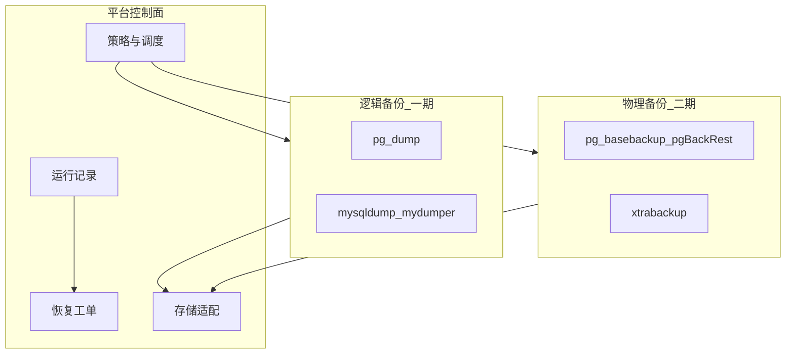
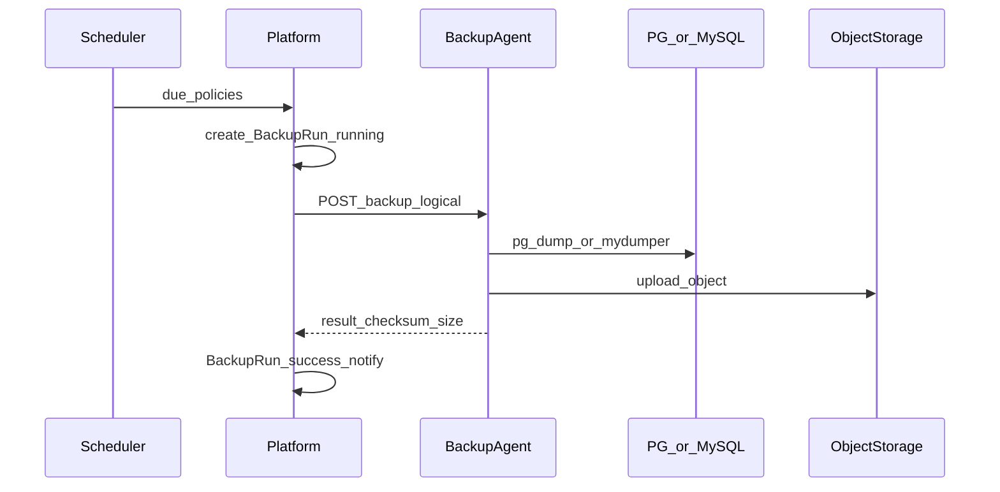

# 数据库备份管理系统 — 专业设计方案（PostgreSQL / MySQL）

面向 KeePlus（工程仓库 auto-dba）的备份管理能力设计。当前仓库**无**独立备份/恢复/PITR 模块；闪回消费 WAL/binlog 做误操作恢复，归档的「备份到目标」是行级复制，均不等于库级备份。本方案在现有**工单 + 调度 + 运行记录 + OSS 配置形态**上新建备份子系统，由平台统一管理。

## 1. 目标与边界

### 1.1 目标

| 能力 | 说明 |
|------|------|
| 策略管理 | 按已登记实例制定全量/增量/逻辑备份策略与调度 |
| 执行与观测 | 平台触发或定时执行，记录运行、大小、耗时、校验结果 |
| 存储管理 | 本地目录 + 对象存储（S3 兼容）；保留期与过期清理 |
| 恢复 | 逻辑恢复（指定库/表）；物理恢复与 PITR（分阶段） |
| 治理 | 审批（高危恢复）、权限、邮件告警、与实例 RBAC 对齐 |

### 1.2 边界（一期 / 二期）

| 一期（可运营的逻辑备份） | 二期（物理 + PITR） |
|--------------------------|---------------------|
| PG：`pg_dump` / `pg_dumpall`（库级、可选 schema） | PG：`pg_basebackup` + WAL 归档 / wal-g 或 pgBackRest |
| MySQL：`mysqldump` / `mydumper`（库级、可选表） | MySQL：xtrabackup / mariabackup + binlog |
| 调度、保留、校验（size/CRC 或 `--verify`）、列表与下载 | 时间点恢复工单、从库重建流程 |
| 存储：本地 workdir + S3 兼容上传下载 | Agent 侧物理备份（避免平台主机直连大盘） |
| 恢复：逻辑导入到**已登记目标实例**（需审批） | 裸机/新实例拉起、云盘快照联动 |

**明确不做（除非后续立项）**：Oracle/SQL Server；用备份替代闪回做秒级行恢复；平台进程内长期占满磁盘存多套全量而不做保留清理。

## 2. 专业选型原则

| 维度 | PostgreSQL | MySQL |
|------|------------|-------|
| 逻辑全量 | `pg_dump -Fc` / 目录格式；大库建议并行 `-j` | `mydumper` 优先（并行）；小库可用 `mysqldump --single-transaction` |
| 一致性 | 逻辑备份依赖事务快照；超大库关注锁与长事务 | InnoDB + `--single-transaction`；DDL 中注意 FTWRL |
| 增量 | 逻辑增量成本高，一期以**定时全量 + 保留链**为主 | 同左；binlog 增量归二期物理/PITR |
| PITR | 需 basebackup + 连续 WAL | 需 xtrabackup + 连续 binlog |
| 执行位置 | **备份 Agent**（与库同机房或可直连实例的跳板），平台只编排 | 同左 |

**为何引入 Backup Agent（与 MHA Agent 同思路）**

- 平台主机不宜直接拉 TB 级 dump、也不宜持有所有库的文件系统权限。
- Agent 白名单执行 `pg_dump`/`mydumper`，结果落到本地盘再上传对象存储；平台登记 Agent Base URL（可与实例/环境绑定）。
- 小规模/开发环境允许「平台内嵌执行器」直连实例跑逻辑备份（配置开关），生产默认 Agent。

## 3. 领域模型

| 实体 | 职责 |
|------|------|
| `BackupStorage` | 存储后端：local / s3；endpoint、bucket、前缀、凭证（加密） |
| `BackupAgent` | 可选；Base URL、鉴权、支持的引擎、标签（机房） |
| `BackupPolicy` | 绑定 `instance_id`（+ 可选 `database` 列表）、引擎、方式（logical_full）、调度 cron、保留天数、压缩、并行度、存储、是否启用 |
| `BackupRun` | 一次执行：状态 pending/running/success/failed、起止、大小、对象键、校验和、日志摘要、触发源（manual/cron/ticket） |
| `BackupSet` | 成功产物索引（可与 Run 1:1）；用于恢复选择 |
| `RestoreTicket` / Issue | 恢复申请：目标实例、备份集、库表范围；审批后执行 |

表建议：`tbl_backup_storages`、`tbl_backup_agents`、`tbl_backup_policies`、`tbl_backup_runs`（可含 set 字段）。工单类型：`IssueTypeBackupRestore`（恢复）；备份策略启用可走轻量审批或仅管理员（产品默认：**策略变更需权限，定时备份不逐次审批；恢复必须工单审批**）。

## 4. 平台功能与页面

侧栏建议挂在「数据安全」下，与闪回、归档并列：

| 页面 | 路径 | 说明 |
|------|------|------|
| 备份概览 | `/ops/backup/dashboard` | 近 24h/7d 成功率、失败列表、磁盘/对象存储用量摘要 |
| 备份策略 | `/ops/backup/policies` | CRUD、启用/停用、立即执行 |
| 执行记录 | `/ops/backup/runs` | 过滤实例/状态、日志、校验、下载链接（预签名） |
| 发起恢复 | `/ops/backup/restore` | 选备份集与目标实例，提交恢复工单 |
| 备份存储 | `/ops/backup/settings` | 存储池、全局默认保留、并发上限 |
| 平台 Agent | `/config/agents` | **配置中心**：登记 / 下发 / 归属；策略按归属 `backup` 引用 |

权限 URN 示例：`um.sidebar.ops-backup*`、`um.action.backup.policy.edit`、`um.action.backup.run`、`um.action.backup.restore`。

## 5. 端到端流程

### 5.1 备份

失败：Run=`failed` + 邮件（复用通知配置，建议增加 `email_on_backup_failed`）；不覆盖上一成功集。

### 5.2 恢复（逻辑）

1. 用户选 BackupSet + 目标实例（须已登记、有权限）。
2. 预检：引擎匹配、目标空间、对象可下载、目标非生产需二次确认（全局参数）。
3. 提交恢复工单 → 审批 → 异步执行：Agent 下载 → `pg_restore` / `mysql` 导入。
4. 结果写入工单 `exec_result` 与 Run/Restore 记录。

生产库恢复默认**强制审批 + 维护窗口提示**；禁止无审批的一键覆盖。

## 6. Agent API 契约（一期逻辑备份）

与 MHA Agent 类似的薄 HTTP 服务，部署在可访问数据库的主机：

| 方法 | 路径 | 作用 |
|------|------|------|
| GET | `/healthz` | 探活 |
| POST | `/v1/backup/logical` | body: engine, dsn 引用或连接参数由平台下发临时票据、database、format、parallel、dest |
| GET | `/v1/backup/jobs/:id` | 查询进度 |
| POST | `/v1/restore/logical` | 下载对象 + restore |

安全：

- BasicAuth / Token；仅允许白名单二进制；
- 连接串由平台下发**短时票据**或 Agent 本地读实例侧凭证，避免日志打印密码；
- 并发与磁盘水位限制；超时与平台 `AsyncAutoExecMaxWait` 对齐量级。

## 7. 调度、保留与校验

| 项 | 建议 |
|----|------|
| 调度 | 复用归档式 30–60s ticker + cron（5 段）或 `HH:MM`；错峰（按 instance hash） |
| 保留 | 按策略 `retention_days`；成功集超期删除本地+对象；最少保留最近 N 份成功全量 |
| 校验 | 上传后 ETag/CRC；可选恢复到临时库做 smoke（二期）；一期至少 size>0 + dump 尾部完整性 |
| 并发 | 全局与单 Agent 槽位；同一实例同时仅 1 个逻辑全量 |

## 8. 与现有模块关系

| 模块 | 关系 |
|------|------|
| 实例/已登记库 | 备份目标必须已登记；权限跟实例可见性 |
| 归档 `backup_target` | 表级迁出，**不替代**本备份；文档中区分命名 |
| 闪回 | 短时误操作恢复；备份负责灾难与长期保留；互补 |
| 迁移 OSS 配置 | 可复用连通性字段形态，备份建议独立 `backup_storage_*` 全局参数并实现真正 Put/Get |
| 通知 | 失败/长时间 running 告警提交人或值班邮箱 |
| HA | 备份默认打**当前主**或策略指定角色；切换后策略仍绑集群/实例 ID |

## 9. 实施分期（建议）

### P0 — 控制面 + 逻辑备份可跑通

1. 表结构、RBAC 菜单、API、策略 CRUD、手动执行、Run 列表  
2. 内嵌执行器（小规模）或最小 Agent + local/S3 存储  
3. PG `pg_dump -Fc`、MySQL `mydumper`/`mysqldump` 适配  
4. 失败通知、基础校验、文档  

### P1 — 生产可用

1. 定时调度、保留清理、预签名下载  
2. 逻辑恢复工单 + 审批 + 异步执行  
3. Agent 强制用于生产（配置）、仪表盘  

### P2 — 物理与 PITR

1. pgBackRest / wal-g 或 basebackup+WAL；xtrabackup+binlog  
2. PITR 工单（时间点、目标实例）  
3. 备份链、增量依赖校验  

## 10. 成功标准（一期）

1. 能对已登记 PG/MySQL 实例配置策略并手动跑通一次逻辑全量，产物进本地或 S3。  
2. Run 可查状态/大小/失败原因；失败有邮件（若开启）。  
3. 能选成功备份集发起恢复工单，审批后导入到指定已登记实例。  
4. 文档明确与闪回、归档「备份到目标」的差异；生产推荐 Agent 部署方式。  

## 11. 风险与专业注意点

- **大库窗口**：逻辑备份时长与主库负载；生产应用并行工具与限流，必要时从库备份（策略勾选「优先只读副本」+ 延迟阈值）。  
- **权限**：备份账号最小权限（PG 可读；MySQL SELECT + REPLICATION 视工具而定）。  
- **加密**：对象存储服务端加密；凭证进 `password_enc`。  
- **合规**：保留期与删除审计；恢复操作全量记工单。  
- **勿与闪回混淆**：闪回不产生可保留的全库备份集。

## 12. 文档与代码落点（实现时）

| 项 | 建议路径 |
|----|----------|
| 后端 | `internal/backup/`（engine、agent client、storage）、`internal/handler/backup.go`、`IssueTypeBackupRestore` |
| 调度 | `server.go` 注册 `backup.StartScheduler` |
| 前端 | `frontend/src/views/backup/*`，路由 `/ops/backup/*` |
| Agent | `deploy/backup-agent/`（产品名 **平台 Agent**，制品 `platform-agent`；与 MHA Agent 思路一致） |
| 说明 | 本文；`docs/features.md` 增加「数据备份」入口 |

**P0 已落地**：表结构 / 策略 CRUD / 手动+定时执行 / Run 列表 / 内嵌 `pg_dump`·`mysqldump`·`mydumper` / local+S3 / 最小 Backup Agent / 失败邮件开关。恢复工单、仪表盘、保留清理见 P1。

**P2 物理备份已落地（执行侧）**：`physical_full` / `physical_incr`；强制 Agent；PG `pg_basebackup`；MySQL `xtrabackup`/`mariabackup` 全量+增量链（`parent_run_id`）；PG 增量请走 WAL/pgBackRest（未内置）。PITR 恢复工单仍待后续。

### Agent SSH 下发（平台编排）

| 项 | 说明 |
|----|------|
| 前置 | 登记 **host** 实例；`terminal.ssh_identity_file`；`backup.agent_artifact`（一体/后端包已含制品；源码环境可 `bash deploy/backup-agent/build.sh`）；`remote_dir` 须对 SSH 用户可写（默认 `/home/sysadmin/auto-dba/platform-agent`，勿用无权限的 `/opt`） |
| 实现 | `internal/sshx`（Go SSH/SFTP，容器无需 openssh-client）→ 上传二进制 / `start.sh` / unit → 启动 → healthz → 自动 Upsert Agent |
| API | `GET/POST /platform/agents`（兼容 `/backup/agents`）、`?scope=backup|rdb|ha`；deploy/启停/status 同前缀 |
| UI | **配置中心 → 平台 Agent**（`/config/agents`）：下发到主机 + 下发记录；备份设置页仅管存储 |

---

**结论**：平台侧建设「策略 — 调度 — Agent 执行 — 对象存储 — 运行观测 — 恢复工单」闭环；一期以 **PG/MySQL 逻辑全量** 交付可运营能力，二期再上物理备份与 PITR。执行面与 MHA 一样采用 **Agent + 白名单命令**，控制面复用归档调度与工单审批模式，避免在平台主机硬扛备份流量。
