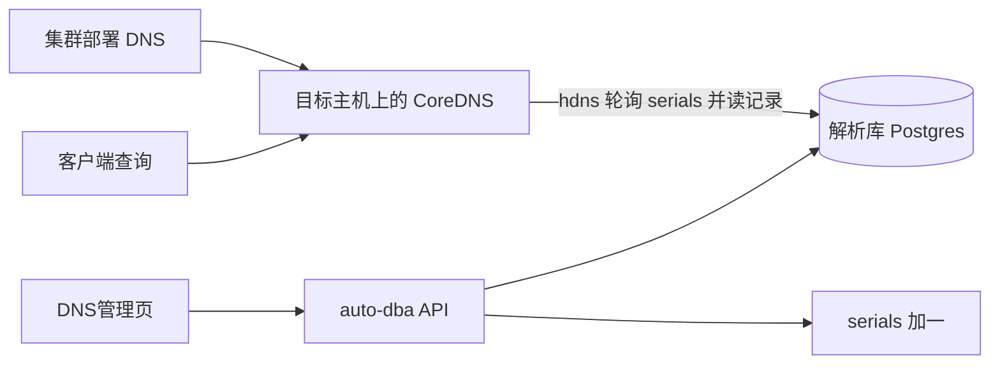

# DNS 独立能力 — 计划

在 auto-dba 内做 DNS 的管理，解析由裁剪编译后的 mars-dns 完成。集群部署把这个二进制装到目标主机。`hdns` 插件源码不改，它自己连 Postgres、按 `serials` 热加载，并按来源 IP 应答。不调用正在运行的 jupiter-dns-api，不把 mars-dns 并进 auto-dba 的 Go module。

已选定方案乙。方案甲（上游 CoreDNS 加区域文件）和方案丙（改 `hdns` 的数据源为令牌拉取）不实施。

本文件是已核对的实施计划，代码已按本计划落地。

## 1. 目标与边界

### 1.1 目标

| 能力 | 说明 |
|------|------|
| 管理 | 解析域、解析范围（名称 + 来源网段）、记录的增删改查与启停 |
| 应用 | 保存后写入 `hdns` 已经在读的表，并把对应 `serials` 加一。节点上的 `hdns` 约 5 秒内自行重载 |
| 部署 | 集群部署新增 DNS 引擎，下发编译好的 CoreDNS，写入带数据库账号的 Corefile |
| 解析 | 现有 `hdns` 按客户端来源 IP 选择解析范围并返回答案 |

页面交互对齐参考控制台：列表展示主机记录、类型、记录值、解析范围网段、解析范围名称、TTL、状态和描述；新建时支持多行主机名、一条记录值、TTL 预设、解析范围和启停。

### 1.2 已核对的决定

1. DNS 数据全平台一份。租户只控制谁能查看和修改。查询请求里没有租户，`hdns` 只能看来源 IP。
2. 不同环境靠「解析范围 + 来源网段」区分，不复用环境管理里的 dev / test / prod。
3. 保存后自动生效，不设单独的「下发」按钮。记录变更只增加 `serials`，不重写 Corefile。
4. 查询行为与当前 `hdns` 一致，见第 6 节。自建域内没有的名字要返回 NXDOMAIN，靠「不写 fallthrough」加上一个名为 `DEFAULT` 的空解析范围，而不是改插件。
5. 现网 jupiter / mars-dns 继续各自运行。本功能上线后不自动替换它们。要切流须另行把客户端 DNS 指到本项目部署的 CoreDNS。

### 1.3 这一期不做

- 不访问正在运行的 jupiter，不读现网 DNS 库，不迁移现网记录
- 不修改 `hdns`、`hhosts` 的查询逻辑，不把证书、CDN、hosts 做进本项目
- 不自写 DNS 协议栈，不用区域文件代替 `hdns`
- 不做 DNSSEC、主从区域传送
- 不把记录回写实例「域名管理」
- 不支持互相重叠的来源网段

### 1.4 编译物

mars-dns 是旧版 CoreDNS（Caddy v1，Go 1.20）。`hdns` 写在这棵树里，不能挂到更新的上游 CoreDNS 上再编译。构建在 mars-dns 目录进行：用本仓库的 `deploy/coredns/plugin.cfg` 覆盖它的 `plugin.cfg`，执行该仓库已有的 `go generate && go build`，产物拷到 `deploy/coredns/bin/coredns`。源码不提交进 auto-dba。构建使用 Go 1.20，与平台自身的 Go 1.24 分开。

`plugin.cfg` 只保留解析所需，并保持它们在 mars-dns 原文件中的相对顺序：

| 保留 | 作用 |
|------|------|
| `bind` | 监听部署时指定的地址 |
| `reload` | Corefile 变更后重新加载 |
| `errors` / `log` | 错误与查询日志 |
| `health` / `ready` | 部署步骤确认进程已起来 |
| `hdns` | 读解析库，按来源网段回答自建域 |
| `forward` | 自建域以外，或未命中解析范围时，转发上游 |

从 `plugin.cfg` 去掉的指令不会编进二进制，以后要在 Corefile 里启用必须重新编译。`hdns` 源码里对 `plugin/file` 的引用是内存中的区域查找，保留；去掉的是 Corefile 里的 `file` 指令。

裁掉的管理功能（jupiter 有，本项目不做页面和接口）：

- 证书
- CDN 厂商、CDN 域名、CDN 记录，以及发布、下线、线路
- hosts 记录（对应插件 `hhosts`）
- 记录变更历史
- 模板配置
- jupiter 自己的登录会话

裁掉的解析插件（mars-dns 的 `plugin.cfg` 里有，本二进制不编入）：

- 另一套记录来源：`hhosts`、`hosts`、`file`、`auto`、`etcd`、`route53`、`azure`、`clouddns`、`kubernetes`、`k8s_external`
- 主从与签名：`secondary`、`transfer`、`dnssec`、`sign`
- 改写与策略：`rewrite`、`template`、`acl`、`geoip`、`loadbalance`、`cache`、`dns64`、`autopath`、`minimal`、`header`、`metadata`
- 协议与入口：`tls`、`grpc`、`bufsize`、`nsid`、`any`、`chaos`、`local`、`whoami`、`erratic`
- 观测与调试：`prometheus`、`pprof`、`dnstap`、`trace`、`debug`、`cancel`
- 其余：`root`、`loop`、`on`

### 1.5 裁掉之后的影响

自建域按来源网段回答、域外走上游，这两件事只依赖保留的 `hdns` 和 `forward`。证书、CDN、模板、记录历史、jupiter 登录会话都不参与这条路径，去掉后已写入的 A、AAAA、CNAME、TXT、MX 仍然按第 6 节应答。

会改变运行结果的只有下面几项：

| 裁掉的能力 | 影响 |
|------------|------|
| `hhosts` / hosts 记录 | `hosts` 表里的名字不会被解析。要解析的名字必须写成 `rrs` |
| `cache` | 域外查询不在节点上缓存，每次都打到上游。自建域答案在 `hdns` 内存里，不受影响 |
| `acl` | 不能按来源地址拒绝查询。能连上 53 端口的客户端都可以问，限制放到主机防火墙或网络策略上 |
| `tls`、`grpc`，以及 `hdns` 只读 UDP 对端 | 只有传统 DNS over UDP。应答过大、客户端改走 TCP 时，当前插件会失败 |
| `prometheus`、`dnstap`、`pprof`、`trace` | 没有查询量、延迟、SERVFAIL 指标，也没有查询报文导出。在线只看 `coredns` 表心跳和本机日志 |
| `secondary`、`transfer` | 节点之间不做主从区域传送。每台都要能连解析库，各自加载 |
| `dnssec`、`sign` | 应答不签名。客户端若要求校验签名，这个域是未签名域 |
| `rewrite`、`template`、`geoip`、`loadbalance` | 不能按规则改名、按地理位置生成记录，也不能打乱多条 A 记录的顺序。多地址时顺序与写入顺序一致 |
| `loop` | 上游若指回本节点，没有环路检测，会一直转到超时 |
| 记录变更历史 | 改错了只能再改一次。没有按历史版本回滚 |
| 证书、CDN、模板配置 | 本平台不签发证书、不发布 CDN、不用模板批量生成记录。这些仍留在现网 jupiter，或另行处理 |

`file`、`auto`、`etcd`、云厂商和 kubernetes 插件去掉后，记录只能来自解析库。这是方案乙的数据路径，不减少 `hdns` 已经能回答的类型。

## 2. 运行关系

平台进程不监听 53。目标主机只跑编译出的 CoreDNS。`hdns` 使用 Corefile 中的数据库账号连接解析库，查询路径不经过平台 HTTP。

开发时可以把该二进制跑在 `127.0.0.1:5353`，Corefile 指向本机可连的解析库。正式环境只通过集群部署安装，监听 UDP 53。

## 3. 数据

解析库是元库同一台 Postgres 上的独立库，默认库名 `auto_dba_dns`。平台用配置中的解析库 DSN 读写。DNS 节点使用另一个账号，见第 5.3 节。表结构与 `hdns` 的 ent 一致，表名用它生成代码里的名字，状态值使用它识别的 `Active` / `Removed`。

| 表 | 作用 |
|----|------|
| `zones` | 解析域。`origin` 为带结尾点的域名，另有 `ns`、`mbox`、`serial`、`ttl`、`refresh`、`retry`、`expire`、`mininum`、`status` |
| `parsing_ranges` | 解析范围。`name`、`network_list`（JSON 字符串数组）、`status` |
| `rrs` | 记录。相对主机名 `name`、`type`、`data`、`ttl`、`zone_id`、`parsing_range_id`、`description`、`status` |
| `serials` | `name` + `serial`。记录变更把名为 `hdns-UpdateZones` 的行加一；域或解析范围变更把名为 `hdns-SyncZone` 的行加一 |
| `coredns` | `hdns` 自己每 5 秒按本机 IP 写入心跳。管理页读这张表判断节点在线 |

初始化时写入两行 serial：`hdns-UpdateZones`、`hdns-SyncZone`，以及一条名为 `DEFAULT`、`network_list` 为空、状态为 `Active` 的解析范围。`DEFAULT` 不参与来源匹配，只让「已命中范围但没有记录」时走插件里的缺省查找，从而返回 NXDOMAIN。

记录类型：A、AAAA、CNAME、TXT、MX。同一主机名在不同解析范围可以有不同记录值。唯一键是「域 + 解析范围 + 主机名 + 类型 + 记录值」。主机名存相对名；`@` 表示域本身。`hdns` 拼查询名的方式是 `{name}.{origin}`。

MX 的 `data` 存成 `邮件主机|优先级`，这是 `hdns` 当前的拆分方式。页面上仍按「优先级、邮件主机」填写，写入时再拼成该格式。

停用把 `status` 写成 `Removed`。`hdns` 只加载 `Active`。删除域或解析范围前，仍被 `Active` 记录引用的不允许删除。

来源网段不允许重叠或互相包含。`hdns` 的 `GetIdcByIP` 按读出顺序命中第一条，查询没有按前缀长度排序，重叠时结果不稳定。

## 4. 管理端

菜单是侧栏一级菜单，路径 `/dns`，标题「DNS管理」。旧路径 `/config/dns` 会跳转到 `/dns`。

权限：

| URN | 含义 |
|-----|------|
| `um.sidebar.config-dns` | 查看 |
| `um.action.dns.create` | 新建域、范围、记录 |
| `um.action.dns.edit` | 修改与启停 |
| `um.action.dns.delete` | 删除 |

接口：

- 解析域、解析范围的增删改查。范围包含网段列表。保存范围或域时将 `serials.name = hdns-SyncZone` 加一。
- `GET /dns-records`：按域、范围、类型、状态、主机名筛选，分页。
- `POST /dns-records`：多行主机名共用类型、记录值、TTL、解析范围和状态。每一行写一条 `rrs`。
- `PUT /dns-records/:id`、`DELETE /dns-records/:id`。
- 记录的增删改和启停将 `serials.name = hdns-UpdateZones` 加一。

列表列：主机记录、类型、记录值、解析范围网段、解析范围名称、TTL、运行开关、描述、查看 / 编辑 / 删除。运行对应 `Active`，停止对应 `Removed`。顶栏选择解析域。另有节点列表，数据来自 `coredns`，`updated_time` 超过 30 秒视为离线。

新建弹窗：记录类型、多行主机名（右侧显示 `.{域名}.`）、一条记录值、TTL 预设（1 分钟、5 分钟、10 分钟、30 分钟、1 小时、12 小时、24 小时，默认 10 分钟）、解析范围、解析域、停止或运行、描述。名为 `DEFAULT` 的解析范围不出现在新建记录的下拉里。

## 5. 集群部署怎么做

DNS 不进平台进程。安装走现有集群部署：Hub 增加引擎，工作台提交变更单，目标主机上已有的 DB Agent 落盘并拉起 CoreDNS。变更单写的是 Corefile 和二进制，不携带记录。

### 5.1 入口

在 [internal/dbdeploy/registry.go](internal/dbdeploy/registry.go) 的 `AllEngines` 增加一条：

| 项 | 值 |
|----|----|
| ID | `dns` |
| 家族 | 域名服务 |
| 工作台 | 沿用 dbdeploy 变更单，拓扑只有「单节点 / 多节点」，节点角色都是 `dns` |
| 能力 | 自建安装。无云厂商、无主从复制、无 VIP |
| 路径 | `/ops/cluster-deploy/dns` |

工作台要填：已登记主机、监听地址（默认 `0.0.0.0:53`）、上游 DNS、解析库在节点上可访问的地址和端口。库名、账号、密码来自平台配置，不在每个节点单独填写。

### 5.2 前置

目标主机必须已经有 DB Agent。没有 Agent 时，部署单在探活步骤失败，并提示先下发 DB Agent。节点必须能访问第 5.1 节填写的解析库地址。

### 5.3 变更单步骤

对每个节点顺序执行：

1. **探活 Agent**：沿用 `agents_health`。
2. **预检**：53/UDP 未被其它进程占用；目录 `/usr/local/auto-dba/dns` 可写。本机已是本次要升级的 CoreDNS 时允许占用 53。
3. **安装二进制**：平台本机产物 `deploy/coredns/bin/coredns`。Agent 写到 `/usr/local/auto-dba/dns/coredns`，模式 `0755`。
4. **写 Corefile**：`/etc/auto-dba/dns/Corefile`，模式 `0600`。内容为监听地址、`hdns` 的 host/port/db/user/password、`check_intervial 5s`、`refresh 20m`、`marsdns_name` 为主机名，然后是 `forward` 指向上游。不写 `fallthrough`，不写 `parsing_range_ids`。解析库账号只授予该库的 `zones`、`rrs`、`parsing_ranges`、`serials` 的 `SELECT`，以及 `coredns` 的 `SELECT`、`INSERT`、`UPDATE`。
5. **安装 systemd**：单元名 `auto-dba-coredns.service`，`ExecStart` 为二进制加 `-conf` 指向 Corefile，`Restart=on-failure`。沿用 Agent 的 `SystemdInstall`。
6. **启动**：`systemctl enable --now`。失败则变更单停在该节点。
7. **确认心跳**：等待 `coredns` 表出现该主机 IP。超时则该节点失败。管理页此后只读这张表，不从平台去连 53 端口。

多台主机按节点循环。一台失败不影响已成功节点，变更单整体标失败并列出失败主机。

### 5.4 和记录维护的分界

集群部署安装进程、更换上游、解析库地址或账号。解析域、解析范围、记录在 DNS管理 修改，只增加 `serials`。`hdns` 约每 5 秒对比 `hdns-UpdateZones` 与 `hdns-SyncZone`，有变化才重载。全量刷新周期 20 分钟。

升级覆盖二进制。Corefile 在监听、上游或解析库连接没有变化时保留。更换解析库密码时须重跑变更单，把新密码写入各节点 Corefile。

## 6. 解析行为

以下均来自当前 `hdns`，实施时不改这些分支。

1. 启动时先 `SyncZone`。解析域和解析范围都至少有一条 `Active` 记录后，加载才会成功。库暂时不可达时进程仍由 systemd 拉起，插件按周期重试。
2. 查询名不属于任何 `Active` 解析域时，交给 Corefile 里的 `forward`。
3. 客户端 IP 与 `parsing_ranges.network_list` 匹配。命中后只用该范围的 `Active` 记录。未命中任何范围时交给 `forward`。
4. 已命中范围但没有该名字时，再查名为 `DEFAULT` 的范围。`DEFAULT` 中也没有时，因 Corefile 不写 `fallthrough`，返回 NXDOMAIN。有名字但没有所查类型时返回 NOERROR 且 Answer 为空。
5. A/AAAA 的值是 IP。CNAME 的值是目标名。TXT 原样。MX 按 `邮件主机|优先级` 解析，拆不开的记录跳过。区内答案由插件内的区域查找给出。
6. 插件只从 UDP 连接读取客户端 IP。TCP 查询在当前代码里会失败。这一期客户端使用 UDP，不改插件。
7. 解析库不可达时，`hdns` 保留内存中上一份数据继续应答，并在日志中记录失败。

## 7. 验收

1. 同一主机名在 office 与 test 两个范围各有一条 A 记录，从对应网段用 UDP 查询，得到各自的地址。
2. 新建或修改后数秒内，不重启 CoreDNS，dig 结果变为新值。
3. 停用或删除的记录不再被返回。
4. 自建域中不存在的名字返回 NXDOMAIN；其它域名能经上游解析；未命中任何解析范围的来源走上游。
5. 保存两条重叠网段时接口拒绝。
6. 无 DNS 权限的用户打不开管理页，不能调用写接口。
7. 集群部署 Hub 能看到 DNS 引擎。装到一台主机后，`coredns` 表出现该节点，平台进程本身不监听 53。
