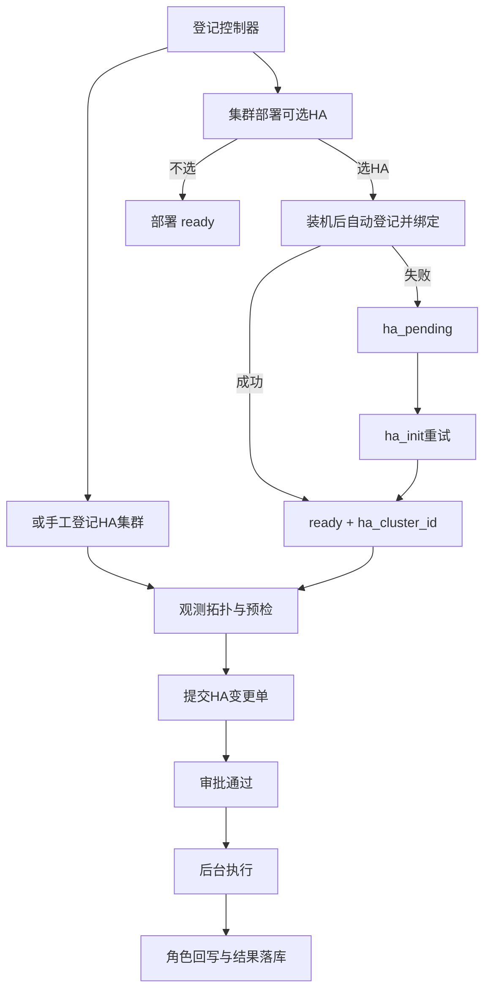

# 高可用服务维护（HA）

路径：`/ops/ha`。用于登记 MySQL / PostgreSQL / Redis 高可用集群、观测拓扑、维护进出、提交计划切换变更单。

与 **集群部署** `/ops/cluster-deploy`（装包/初始化/扩缩/升级编排，按引擎工作台）职责不同：本页只管**已有 HA 拓扑**的观测与计划切换，不负责新建集群装机。StarRocks 生命周期见 [sr-cluster.md](sr-cluster.md)。

## 平台管什么、不管什么

| 平台管 | 平台不管 |
|--------|----------|
| 集群/成员/控制器登记与绑定 | 在平台进程内嵌 HA 软件 / 选主逻辑 |
| 拓扑与复制探测、预检、审计 | 业务库主机 SSH / 私钥（由 Manager/Agent 侧账号承担） |
| 经「控制器」下发**计划切换 / 强制切换** | 无审批的自动切主 |
| MHA / pg_auto_failover / Patroni 版本登记与 OSS 代装 | VIP / ProxySQL / PgBouncer **脚本内容本身**（可配置钩子触发） |
| manager / Keeper systemd 启停观测 | 代装并托管 etcd 集群 |
| 维护态、工单审批、角色回写 | |

一句话：平台是调度台 + 审批 + 审计；Orchestrator / MHA Agent / **pg_auto_failover Agent** / Patroni / repmgr Agent / Sentinel 是受控执行入口。  
**自动 failover** 仍由现场守护进程执行；平台负责接入、审批后的计划/强制切换与审计。  
**MySQL / PostgreSQL 自建主从**可在 [集群部署](db-cluster.md) 初始化时勾选 HA，装机成功后自动登记；日常切换仍只在本页。

### VIP 责任矩阵（与集群部署对齐）

| 环节 | 谁负责 | 说明 |
|------|--------|------|
| 业务 VIP 元数据 | 部署向导 / HA 集群字段 | 登记入口；钩子环境变量 `HA_VIP` |
| MHA `master_ip_*_script` | 部署 `ha_options_json` 或本页「MHA 配置」 | 路径写入 app.cnf；**内容**现场维护 |
| `vip_hook_*` | 部署写入 Remark，或本页改备注 | 切换成功后 Agent 触发 |
| keepalived / LVS | [接入层代理](proxy.md) | 不与 MySQL·MHA 装机流水线合并 |

推荐：部署勾选 MHA → 填 VIP + failover 脚本 → 自动下发 app.cnf → 切主在本页（钩子带 `HA_VIP`）。

### 切换后 VIP 钩子（可选）

集群备注 JSON 可配置现场脚本路径（脚本须落在 Agent 允许目录）；**集群部署**勾选 HA 时亦可一并写入：

```json
{
  "note": "由集群部署自动接入",
  "vip_hook_script": "/etc/auto-dba/hooks/vip.sh",
  "vip_hook_args": ["--vip", "10.0.0.50"],
  "hook_agent_url": "http://agent:8090"
}
```

平台在审批通过的切换成功后调用 Agent `POST /v1/ha/hook/run`；**不编写脚本业务逻辑**。若集群已登记 VIP，钩子环境变量自动带上 `HA_VIP`。

## 页面结构

| Tab | 作用 |
|-----|------|
| 观测 | 集群列表、拓扑探测、延迟与健康度；pgaf/Patroni 状态；Keeper systemd 启停 |
| 变更 | 发起维护进出 / 计划内切换 / **主宕机强制切换**（走工单审批） |
| **MHA 配置** | app.cnf 模板、下发、**manager 启停状态**、版本安装向导 |
| **MHA 版本** | 登记 manager/node 分包、绑定 OSS、presign |
| **PG·pgaf 版本** | pg_auto_failover 制品登记与代装 |
| **PG·Patroni 版本** | Patroni 制品登记与代装（代装经 Agent；REST 控制器可配 `package_agent_url`） |
| 治理 | HA 任务 / 变更单列表，跳转工单详情 |
| 控制器 | 登记外部 HA 组件；支持 env-check（mha/orch/proxysql/pgaf/patroni/repmgr） |

## MySQL · MHA 能力

| # | 能力 | 说明 |
|---|------|------|
| 1 | Manager / Agent 节点 | 平台 Agent（归属高可用）或独立 mha-agent |
| 2 | 配置管理与下发 | 「MHA 配置」：保存草稿 → 下发 Agent；成功后可一键重启 manager |
| 3 | 架构校验 | 恰好 **1 primary + ≥1 replica** |
| 4 | 专业模板 | `[server default]` + 多 `[serverN]` |
| 5 | 计划 / 强制切换 | 审批后 stop manager → alive/dead switch → start manager |
| 6 | 成员来源 | 已登记实例或集群部署 MySQL 主从导入 |
| 7 | 版本与代装 | `tbl_mha_releases` + OSS presign；Agent `rpm -Uvh`/`dpkg -i`（本机 + SSH 装 node） |
| 8 | manager 生命周期 | systemd unit `mha-manager@<conf-stem>` 启停/status |

### 产品补足

- 控制器环境检查、下发后 verify_repl
- 强制切换预检：主不可达、manager 状态、风险文案；**不可跳过预检**
- 切换编排前后自动 stop/start manager

## 控制器（Base URL 填什么）

控制器 = 平台调用外部 HA 工具的地址与鉴权，**不是**数据库实例地址。

| 类型 (kind) | 引擎 | Base URL 示例 | 说明 |
|-------------|------|---------------|------|
| `orchestrator` | MySQL | `http://orchestrator:3000` | Orchestrator HTTP API；支持强制切换；备注可填 `cluster_alias` |
| `mha` | MySQL | `http://192.168.1.10:8090` | **平台 Agent**（归属含高可用）或独立 mha-agent |
| `proxysql` | MySQL | `mysql://proxysql:6032` 或 `host:6032` | Admin 口；计划切换更新 writer HG；备注 JSON 可配 `writer_hostgroup` |
| `pg_autofailover` | PostgreSQL | `http://monitor-agent:8090` | **平台 Agent**（Monitor 同机，需 `pg_autoctl`） |
| `patroni` | PostgreSQL | `http://patroni-host:8008` | Patroni REST；代装时备注可加 `package_agent_url` |
| `repmgr` | PostgreSQL | `http://agent:8090` | **平台 Agent**；计划切换 `repmgr standby switchover` |
| `sentinel` | Redis | `host:26379` 或 `redis://host:26379` | Sentinel |

用户名/密码：填该组件或 Agent 的 HTTP BasicAuth（若未开启可留空）。

### MHA：选用平台 Agent（推荐）

1. 在 **配置中心 → 平台 Agent** 下发/登记，勾选归属 **高可用**（主机需有 `masterha_*`）。
2. 「高可用服务维护 → 控制器」登记：引擎 MySQL、类型 **MHA**、接入方式选 **选用平台 Agent**。
3. 「app.cnf 路径」写入控制器备注；默认 `/etc/mha/app.cnf`。
4. 平台调用该 Agent 的 `/v1/mha/*`（与独立 mha-agent 同路径）。

也可继续手填独立 [mha-agent](../deploy/mha-agent/README.md) 的 Base URL。

### PostgreSQL · pg_auto_failover（推荐自建）

产品定位：与 MySQL MHA 对称——**Monitor 侧平台 Agent** 白名单执行 `pg_autoctl`；Keeper 在各 PG 节点由现场安装；平台不做选主 FSM。

1. Monitor 主机安装 [pg_auto_failover](https://pg-auto-failover.readthedocs.io/) 与平台 Agent（归属「高可用」）。
2. 登记控制器：引擎 PostgreSQL、类型 **pg_auto_failover**；备注 JSON：
   ```json
   {"formation":"default","group":"0","monitor":"postgres://autoctl_node@monitor:5432/pg_auto_failover"}
   ```
   或本机 `--pgdata` 路径。
3. 登记集群：模式 `pg_autofailover`，**1 primary + ≥1 replica**，绑定上述控制器。
4. 变更单：计划切换 → `pg_autoctl perform switchover`（可指定节点 `perform promotion`）；强制切换 → `perform failover`（须预检，不可跳过）。
5. Agent API：`GET /v1/pgaf/status`、`POST /v1/pgaf/switchover|failover`；环境检查 `POST /v1/ha/env-check` kind=`pg_autofailover`。
6. Keeper/Monitor 生命周期：平台可经 Agent `systemctl start|stop|restart|status`（默认 unit `pgautofailover`）；观测页有快捷按钮。
7. 版本代装：「PG·pgaf 版本」登记后下发到 Monitor 本机与成员节点（keeper）。

### PostgreSQL · Patroni

1. 登记控制器 kind=`patroni`，Base URL = Patroni REST（如 `http://patroni:8008`）。
2. 计划切换：`POST /switchover`；强制切换：`POST /failover`（审批后）。
3. 自动 failover 仍由 Patroni + DCS 负责；**平台不代装 etcd**。
4. 版本代装（可选）：「PG·Patroni 版本」登记 rpm/deb；若 REST 与 Agent 不同机，控制器备注加 `{"package_agent_url":"http://agent:8090"}`。

### PostgreSQL · repmgr

1. 登记控制器 kind=`repmgr`，Base URL = 可执行 `repmgr` 的平台 Agent。
2. 计划切换：Agent `POST /v1/repmgr/switchover`（`repmgr standby switchover --siblings-follow`）。
3. 环境检查：`cluster show`。

### MHA 专用（手动 URL）

1. 在 MHA Manager 机器部署 Agent（见仓库 [`deploy/mha-agent/README.md`](../deploy/mha-agent/README.md) 或平台 Agent）。
2. 平台登记控制器：引擎 MySQL、类型 **MHA**、Base URL = `http://<manager主机>:<agent端口>`。
3. 「app.cnf 路径」写入控制器备注：纯路径如 `/etc/mha/app.cnf`，或 JSON `{"app_conf":"/etc/mha/app1.cnf"}`；默认 `/etc/mha/app.cnf`。
4. **自动 failover** 仍由现场 `masterha_manager` 负责；平台可 **systemd 启停** 该进程，并经 Agent 执行审批后的计划切换 / 强制切换。

Agent 常用启动：

```bash
# 平台 Agent（含备份/RDB/HA）
./platform-agent -listen :8090 -user agent -pass '***' -conf-root /etc/mha

# 或独立 mha-agent
./mha-agent -listen :8088 -user agent -pass '***' -conf-root /etc/mha

# 本机自测（不真正执行 masterha_*）
go run ./deploy/backup-agent -listen :8090 -dry-run -conf-root /tmp/mha
```

## 集群模式与是否自动切换

登记集群时选择**模式**；部分模式**必须**绑定兼容控制器，审批通过后由平台自动调用控制器完成计划切换。

### MySQL

| 模式 code | 说明 | 自动切换 |
|-----------|------|----------|
| `manual` / `async_repl` | 人工 / 异步复制 | 否（检查清单） |
| `orchestrator` | 复制 + Orchestrator | 是（计划 + 强制） |
| `mha` | 复制 + MHA | 是（计划 + 强制） |
| `proxysql_repl` | ProxySQL + 复制 | 是（更新 writer HG） |
| `mgr` / `pxc` | 组复制 / Galera | 否（加固预检 + 清单；平台不发组选举命令） |
| `shared_storage` / `k8s_operator` | 见页面 hint | 否（清单） |

### PostgreSQL

| 模式 | 自动切换 | 说明 |
|------|----------|------|
| `manual` / `async_repl` | 否 | 流复制登记与清单 |
| `pg_autofailover` | 是（须绑 Monitor Agent） | 计划/强制经 `pg_autoctl`；版本代装；Keeper systemd 启停 |
| `patroni` | 是（须绑 patroni REST） | `/switchover` 与 `/failover`；可选制品代装 |
| `repmgr` | 是（须绑 Agent） | `repmgr standby switchover` |
| `k8s_operator` | 否 | 登记 + 清单 |

### Redis

| 模式 | 自动切换 |
|------|----------|
| `manual` / `cluster` | 否 |
| `sentinel` | 是（须绑 sentinel） |

成员要求：实例须已在「实例管理」登记，且类型与集群引擎一致；同一集群仅允许一个 `primary`。成员 Host/Port 须与现场 HA 配置（如 MHA `app.cnf`）一致，否则切换会失败或切错节点。

## 推荐操作流程



1. **登记控制器**（需要自动切换时）。
2. **（推荐）集群部署**：MySQL 自建主从创建时勾选 HA、选模式与控制器；部署流水线在复制验收后自动接入。失败可工作台「继续接入 HA」。
3. **或手工登记集群**：选引擎、模式、成员、VIP；自动切换模式必须选控制器；也可从 db-deploy 导入。
4. **观测**：打开拓扑，确认主从/延迟；MHA 会附带 Agent status 提示。
5. **变更**：
   - `进入维护` / `退出维护`：更新集群维护态；
   - `计划内切换`：指定新主实例，预检通过后提交工单。
6. **审批**：通过后工单进入执行（HA 类型自动后台执行）；成功则回写成员角色并写 `exec_result`。

失败时工单为「执行失败」，可查看详情中的步骤；MHA 计划切换失败时角色不会盲改。
手工导入或部署自动绑定成功后，db-deploy 集群若为 `ha_pending` 会升为 `ready`。

## 相关 API（需登录）

前缀：`/api/v1/ha`

| 方法 | 路径 | 说明 |
|------|------|------|
| GET | `/meta/modes` | 各引擎模式、默认模式、控制器类型 |
| GET | `/candidates` | 成员候选（已登记实例 + 部署集群节点） |
| POST | `/candidates/import-dbdeploy` | 从 db-deploy 导入并登记实例 |
| GET/POST | `/controllers` | 控制器列表 / 登记 |
| DELETE | `/controllers/:id` | 删除控制器 |
| POST | `/controllers/:id/env-check` | 环境检查（mha/orch/proxysql/pgaf/patroni/repmgr） |
| GET/POST | `/clusters` | 集群列表 / 创建（可带 `dbdeploy_cluster_id`，成功后部署侧升 `ready`） |
| GET/PUT/DELETE | `/clusters/:id` | 详情 / 更新 / 删除 |
| GET | `/clusters/:id/topology` | 拓扑探测 |
| GET | `/clusters/:id/mha/conf` | 读取/预览 MHA conf |
| POST | `/clusters/:id/mha/conf/preview` | 按选项生成模板 |
| PUT | `/clusters/:id/mha/conf` | 保存 conf 草稿 |
| POST | `/clusters/:id/mha/conf/push` | 下发到 Agent（可选 verify_repl） |
| GET | `/clusters/:id/mha/manager/status` | manager systemd 状态 |
| POST | `/clusters/:id/mha/manager/:action` | start / stop / restart |
| POST | `/clusters/:id/mha/packages/install` | 按 release 代装 manager+node |
| GET | `/clusters/:id/mha/packages/runs` | 安装审计 |
| GET/POST | `/mha/releases` | 版本列表 / 登记 |
| PATCH/DELETE | `/mha/releases/:id` | 更新 / 删除版本 |
| POST | `/mha/releases/:id/artifacts` | 登记 manager\|node 制品 |
| POST | `/mha/releases/:id/presign` | OSS 短时下载 URL |
| GET/PUT | `/mha/oss` | MHA 制品 OSS 绑定 |
| GET | `/clusters/:id/pgaf/state` | pg_autoctl show state |
| GET | `/clusters/:id/pgaf/service/status` | Keeper/Monitor systemd 状态 |
| POST | `/clusters/:id/pgaf/service/:action` | start / stop / restart |
| POST | `/clusters/:id/pgaf/packages/install` | pgaf 代装 |
| GET/POST | `/pgaf/releases` … | pgaf 版本与 OSS |
| GET | `/clusters/:id/patroni/cluster` | Patroni /cluster |
| POST | `/clusters/:id/patroni/packages/install` | Patroni 代装 |
| GET/POST | `/patroni/releases` … | Patroni 版本与 OSS |
| POST | `/precheck` | 预检（含 failover_dead） |
| POST | `/changes` | 提交变更单（含 failover_dead） |
| GET | `/tasks` | 任务列表 |

部署侧相关（前缀 `/api/v1/db-deploy`）：

| 方法 | 路径 | 说明 |
|------|------|------|
| POST | `/clusters/:id/ha/preflight` | HA 门禁 + 可选 MHA env-check |
| POST | `/clusters/:id/ha-init` | `ha_pending` 重试接入 |

若 `/meta/modes` 返回 404，说明后端进程未加载最新路由，需重启 `go run` / 服务；前端有本地模式兜底，但不替代后端接口。

## 权限与菜单

页面在「平台运维 → 高可用服务维护」。角色需勾选对应菜单；写操作按 RBAC URN 校验（与其它运维页一致）。详见 [权限登记指南](rbac-permissions.md)。

## 与功能总览的关系

功能入口简述见 [features.md](features.md)「平台运维」；本文为 HA 操作与接入说明。装包/初始化见 [集群部署 · StarRocks](sr-cluster.md)。MHA Agent 部署细节见 [`deploy/mha-agent/README.md`](../deploy/mha-agent/README.md)。
