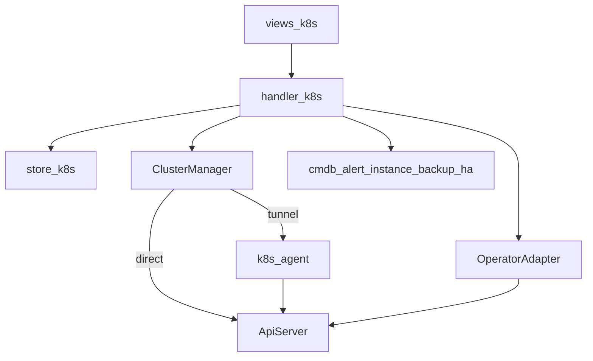

# K8s 管理 — 产品与技术方案

面向 KeePlus（工程仓库 auto-dba）的 Kubernetes 多集群纳管与数据库上 K8s 能力。  
通用 K8s 管理为底座，上层通过 Operator 适配器做 DBaaS；与现有多租户、RBAC、CMDB、告警、备份、HA、工单对齐。

## 1. 目标与边界

### 1.1 目标

| 能力 | 说明 |
|------|------|
| 多集群纳管 | kubeconfig / Token 直连，或 `k8s-agent` 反向隧道 |
| 只读运维 | 节点、命名空间、工作负载、网络、存储、事件、YAML、Pod 日志 |
| 写操作 | 扩缩、重启、回滚、删除、cordon/drain、YAML apply（dry-run + diff） |
| 数据库上 K8s | Operator 中心 + 模板化创建 / 扩缩 / 升级 / 切换 / 备份 |
| 治理 | 多租户命名空间绑定、URN 权限、Impersonate、生产变更工单、审计 |

### 1.2 边界

| 做 | 不做 |
|----|------|
| 纳管已有集群 | kubeadm / RKE 等集群生命周期安装 |
| 工作负载与 CRD 运维 | 完整 CI/CD 流水线 |
| Operator 适配（CNPG 等） | 替代 Rancher 全量能力 |
| Velero / Helm（增强期） | Service Mesh |

## 2. 业界参考与选型

| 维度 | 选型 |
|------|------|
| 纳管 | 直连 API Server；隔离网用 Agent 隧道（参考 Rancher cattle-cluster-agent） |
| 客户端 | `k8s.io/client-go` + dynamic client；常用资源 informer 缓存 |
| PG | CloudNativePG |
| MySQL | Percona Operator for MySQL / PXC |
| Redis | OT-Container-Kit redis-operator |
| StarRocks | StarRocks Operator |
| Kafka（可选） | Strimzi |
| 可观测 | kube-state-metrics / node-exporter，接入现有 Prometheus Ruler |
| 集群备份（P4） | Velero |

## 3. 功能清单（菜单）

| 路径 | 说明 | 阶段 |
|------|------|------|
| `/k8s/clusters` | 纳管、探测、命名空间划拨 | P1 |
| `/k8s/overview` | 资源水位、异常 Pod、事件 | P1 |
| `/k8s/nodes` | 节点；cordon/drain 在 P2 | P1/P2 |
| `/k8s/workloads` | Deploy/STS/DS/Job/CronJob/Pod；日志/YAML | P1 |
| `/k8s/network` | Service / Ingress / NetworkPolicy | P1 |
| `/k8s/storage` | PVC / PV / StorageClass / ConfigMap / Secret 脱敏 | P1 |
| `/k8s/resources` | 通用 CRD 浏览器 | P2 |
| `/k8s/operators` | Operator 检测 / 安装 | P3 |
| `/k8s/db-clusters` | 数据库服务向导与运维 | P3 |
| `/k8s/apps` | Helm 应用 | P4 |

## 4. 多租户与权限

- 集群归属租户；命名空间可通过 `tbl_k8s_namespace_bindings` 划拨/授权给业务租户。
- 集群级资源（Node/PV/SC）仅归属方可见。
- 平台 URN：`um.sidebar.k8s-*`、`um.action.k8s.*`（见菜单种子）。
- 可选 Impersonate：映射 `keeplus:viewer|operator|admin` ClusterRole。
- 凭据 `enc:v2` 加密落库；接口永不回传明文。
- 生产环境高危写操作走「K8s 变更」工单（`k8s_change`）。

## 5. 数据模型

- `tbl_k8s_clusters` — 纳管集群与凭据
- `tbl_k8s_namespace_bindings` — 命名空间 ↔ 租户
- `tbl_k8s_audit_logs` — 操作审计
- `tbl_k8s_operators` — 已检测/安装的 Operator
- `tbl_k8s_db_clusters` — 平台登记的数据库集群 CR 与实例回写

K8s 原生对象不落库，实时（或 informer 缓存）读取。

## 6. 分期

| 期 | 内容 |
|----|------|
| P0 | client-go、ClusterManager、kind 脚本、本文档 |
| P1 | 纳管只读 + 日志 + CMDB/告警模板 + 前端 |
| P2 | 写操作、YAML apply、终端、工单、Agent、informer |
| P3 | OperatorAdapter + CNPG 等 + 实例/HA/备份联动 |
| P4 | Helm、多集群视图、Velero、KubeBlocks、AIOps |

## 7. 待决问题

1. Operator：平台安装 vs 仅检测已装。
2. 隧道：自研 WebSocket vs 引入 remotedialer。
3. 生产判定：集群绑定环境 vs 命名空间标签。
