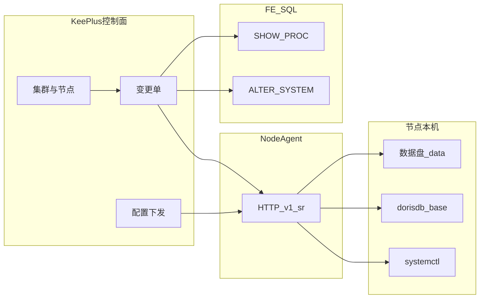
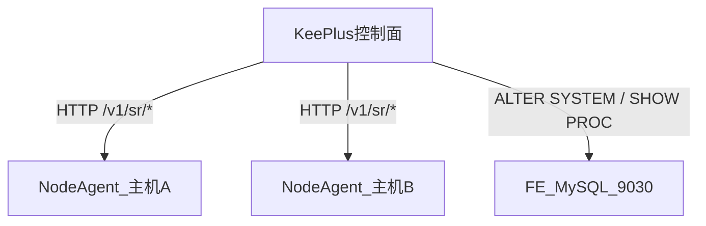
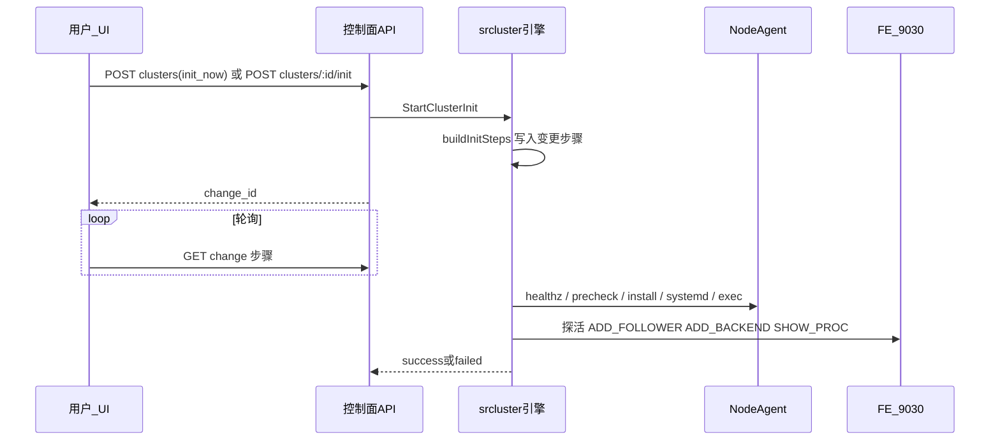
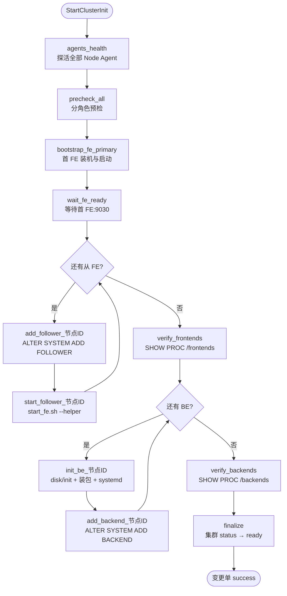
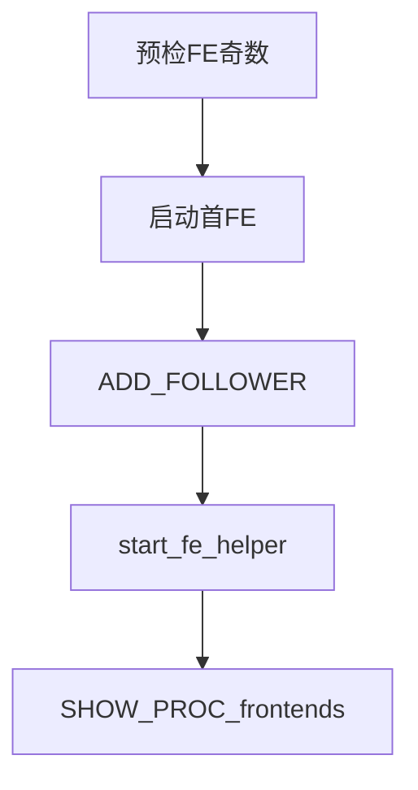
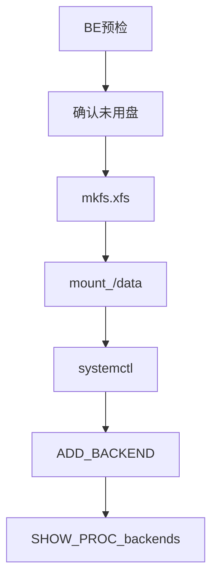
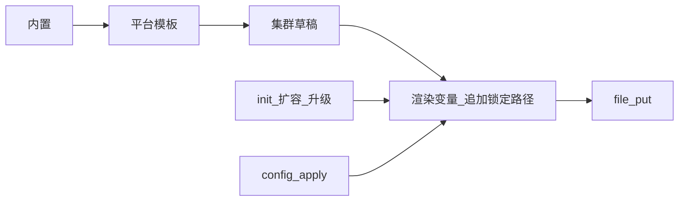

# 集群部署 · StarRocks 工作台（功能方案）

侧栏名称：**集群部署**。入口路径：`/ops/cluster-deploy`（引擎选择 Hub）。StarRocks 工作台：`/ops/cluster-deploy/starrocks`（旧路径 `/ops/sr-cluster` 重定向至此）。菜单 URN：`um.sidebar.ops-cluster-deploy`。内部代号：`cluster_deploy` / `sr_cluster`（API 仍为 `/api/v1/sr-cluster/*`）。

本文描述平台对 StarRocks **集群生命周期**（部署、扩缩、重启、升级、配置下发）的控制面方案，对齐现网手工运维习惯。**预检与部署所涉各节点须安装并登记平台 Node Agent**（见第 3 节）。装机包拉取、conf 正文模板等实施细节可后续补充；**不替代**现有「SR 控制台」FE Web UI 跳转，也不替代 `starrocks` 实例登记 / CDC / 库监控。MySQL / PostgreSQL 等工作台本期仅在 Hub 占位。

### 高危操作须工单审批

下列操作**不可**在页面直接执行编排，须先提交 `issue_type=sr_cluster` 工单（`POST /api/v1/sr-cluster/tickets`），审批通过后自动调用既有 `Start*`：

| 操作 | action |
|------|--------|
| 添加 / 加入节点 | `add_node` |
| 重新初始化 | `cluster_reinit` |
| 升级 | `upgrade`（建单前须 precheck 通过） |
| 下线节点 | `remove_node` |
| 恢复节点（撤销 BE 在线缩容） | `restore_node`（建单时校验该 BE 仍处于下线状态，见 §9.2） |

启停 / 重启 / 配置下发仍可直连变更 API。审批人：`assigned_to` 或全局 `sync_default_approver`，并受 `issue_global_approver_whitelist` 约束；两者都为空时建单返回 400「请选择审批人」。

页面审批人为必选下拉，默认选第一个：下线 / 加入节点按该节点所在主机加载；重新初始化 / 升级按集群全部节点所在主机的审批人合集加载。节点主机解析顺序：节点 `host_instance_id` → 节点 Agent 的 `host_instance_id` → 按地址匹配主机实例。

### 添加节点：Host/Agent 一致、审批人联动、提交前基础校验

弹窗规则（数据库集群工作台同样适用，见 [db-cluster.md](db-cluster.md)）：

1. **Host 从已登记主机选择**（实例管理中 `db_type=host`），节点地址取主机的 Host（空则域名）。Node Agent 下拉**只列出与该主机同地址的 Agent**：`agent.host_instance_id` 等于主机 ID（SSH 下发的 Agent），或 `base_url` 的主机名等于主机 Host / 域名 / Domains 之一。只有一个时自动选中；没有时提示先去「Node Agent」Tab 下发。
2. **审批人按所选主机加载**（`GET /tickets/target-approvers?instance_id=<主机ID>`），默认选第一个；主机未配置审批人时接口回退到 `sync_default_approver` 与全部用户。
3. **先点「基础校验」，全部通过后「提交工单」才可用**；表单任一字段变化会清空校验结果，需要重新校验。

基础校验接口 `POST /api/v1/sr-cluster/clusters/:id/nodes/precheck`，请求体与 `add_node` payload 相同（含 `host_instance_id`、`assigned_to`），返回 `{ok, summary, items[]}`：

| 项 | 说明 |
|----|------|
| `cluster` | 集群存在且无进行中的变更单 |
| `host_instance` | 主机实例存在、类型为 host、有地址，且 Host 属于该主机 |
| `agent_match` | Agent 存在且与主机地址一致 |
| `agent_online` | Agent `/healthz` 5 秒内响应 |
| `duplicate` | 集群内无相同 `component@host` 节点 |
| `role_rule` | 集群已就绪或已有首 FE 时不能勾「首 FE」；BE 数据目录须为绝对路径且不是 `/`，并合并 Agent 的数据目录挂载判定（见 [7.2](#72-be-预检)）；Agent 离线 / 不一致 / 版本过旧（无 `data_root` 项）均判失败 |
| `fe_count` | 仅提醒（不阻断）：扩容后 FE 总数为偶数时，扩容编排会拒绝，需再加一个 FE |
| `agent:*` / `agent_precheck` | Agent `/v1/sr/precheck` 返回的端口等环境检查；`level=warn` 的项（`extra_disk` 磁盘概况、`data_disk_format` 将格式化磁盘、`data_root_nonempty` 数据目录非空）仅提醒 |
| `approver` | 审批人非空（含 `sync_default_approver` 兜底） |

建单时（`POST /sr-cluster/tickets`，`action=add_node` 新建节点）后端会再跑一遍静态校验：`agent_match` / `duplicate` / `role_rule`（以及传了 `host_instance_id` 时的 `host_instance`）失败直接返回 400；Agent 在线、环境预检这类随时间变化的项不在建单时拦截，由编排中的 `agents_health` / `precheck_all` 步骤兜底。

---

## 1. 与现有能力切割

| 现有能力 | 本模块 |
|----------|--------|
| **SR 控制台** `/ops/sr` | 探测并打开 **FE HTTP 控制台** |
| **高可用服务维护** `/ops/ha` | 已有 HA 拓扑的观测与计划切换（非装包/初始化） |
| 实例类型 `starrocks`、查询/工单、CDC 目标、库监控 | 业务连接与观测 |
| **集群部署** `/ops/cluster-deploy` → StarRocks 工作台 | 集群登记、环境×版本、角色与目录、预检、FE/BE 增删与重启、配置统一下发、systemctl、升级（不改数据目录） |



---

## 2. 能力总览

| 能力 | 说明 |
|------|------|
| 集群部署 | 选环境与版本 → 角色与节点 → **预检** → 装机/盘初始化 → conf/unit 下发 → systemctl → SQL 登记 → **SHOW PROC 核验** |
| 新增节点 | 按 FE/BE 分支；FE 须保持**奇数**节点 |
| 删除节点 | FE：`DROP FOLLOWER`；BE：默认 `DECOMMISSION`，危险备选 `DROP BACKEND` |
| 节点重启 | `systemctl restart fe-{port}` / `be-{port}` |
| 集群升级 | 只换软件版本；**禁止变更数据目录** |
| 配置管理 | 集群配置统一管理、统一下发（`config_apply`） |
| 服务管理 | 进程生命周期以 **systemctl** 为准 |
| **节点 Agent** | 预检/部署/启停所涉主机须安装并登记平台 **Node Agent**；日常编排走 Agent HTTP |

---

## 3. 平台 Node Agent 调用方案

### 3.1 定位

凡参与集群**检查、部署、配置下发、启停**的主机，必须有对应 Node Agent。控制面**不**在生产路径上用临时 SSH 执行 mkfs/systemctl；SSH 仅用于 Agent **首次下发**（同 Backup Agent）。



| 执行方 | 职责 |
|--------|------|
| **Node Agent** | 本机预检、磁盘 init、目录/文件、systemd、白名单 exec（如 `start_fe.sh --helper`） |
| **控制面** | 变更编排、版本/奇数策略、连接 FE:9030 执行元数据 SQL 与 SHOW PROC、写审计日志 |

### 3.2 部署与登记

| 项 | 约定 |
|----|------|
| 建议路径 | `deploy/node-agent`（独立进程；勿与 Backup / 平台 Agent 端口冲突） |
| 监听 | 默认 `:8091`（**平台 Agent / Backup Agent** 常用 `:8090`）；约定 Agent 端口带 **8090–8199** |
| 鉴权 | HTTP BasicAuth，密码加密存库 |
| 下发 | **本工作台 Node Agent Tab「SSH 下发」**（复用 sshx，制品 `deploy/node-agent/bin/node-agent`）；亦可手工安装后「手工登记」；支持从监控目标批量 |
| 绑定 | `SrNode.agent_id` → `tbl_sr_agents`；无健康 Agent **禁止**对该节点预检/部署 |
| 探活 | `GET /healthz` |

**对已有集群安全（下发 Agent ≠ 变更业务）**：SSH 下发 / 重新下发 **只**操作 Agent 自身目录与进程（停旧 Agent → 上传二进制 → nohup 拉起），**不会**：

- `systemctl` 启停 FE/BE，或改已有 FE/BE unit / conf
- 触碰 FE/BE 二进制、数据目录，或执行 mkfs / 挂载
- 触发装包、`ADD BACKEND` 等变更编排（那些只走变更单 / Agent HTTP）

停旧 Agent 时仅按 pid / 精确进程名 `node-agent` 杀进程；`fuser -k` **仅**在约定端口带 8090–8199 执行。服务端拒绝将 9030 / 8030 / 8040 等业务端口配置为 Agent 监听，避免误杀已运行服务。

**与配置中心「平台 Agent」切割**：

| | 平台 Agent（配置中心） | Node Agent（本工作台） |
|--|----------------------|------------------------|
| 入口 | `/config/agents`，下发记录 | `/ops/cluster-deploy/starrocks` → **Node Agent Tab（SSH 下发 + 登记）** |
| API 前缀 | `/api/v1/platform/agents` | `/api/v1/sr-cluster/agents`（含 `/deploy`、`/deploys`） |
| 默认端口 | **8090** | **8091** |
| 能力 | 备份 / HA / capabilities 等 | StarRocks `/v1/sr/*`（预检、盘、装包、systemd） |
| 集群登记下拉 | **不会**出现 | **仅**本表可选 |

一体/后端发布包与 Docker 镜像已含 `deploy/node-agent/bin/node-agent`；从源码跑控制面时再执行 `cd deploy/node-agent && ./build.sh`。登记/新建集群时若下拉「暂无数据」，请先在本 Tab SSH 下发或手工登记（仅下发 8090 平台 Agent 不够）。

### 3.3 HTTP API（控制面 → Agent）

统一 JSON + BasicAuth；前缀 `/v1/sr/`。

| 方法 | 路径 | 用途 |
|------|------|------|
| GET | `/healthz` | 探活 |
| POST | `/v1/sr/precheck` | 分角色预检。`role=fe\|be`；返回 `{ok, items[]}` |
| POST | `/v1/sr/disk/init` | BE：`device`、`mount_point=/data`、`fstype=xfs`、`persist_fstab`；校验非系统盘；`auto=true` 时忽略 `device`，按数据目录三条规则自动处理 |
| POST | `/v1/sr/fs/ensure` | `mkdir -p` 路径列表 |
| POST | `/v1/sr/file/put` | 下发 conf/unit（先写 `.new` 再 rename）。`backup=true` 时覆盖前把旧文件复制为 `<path>.bak.<yyyyMMddHHmmss.SSS>`（每个文件保留最近 10 份），并回传 `previous_exists`、`previous_content`、`previous_sha256`、`backup_path` |
| POST | `/v1/sr/file/get` | 只读：`path` 必须是绝对路径且以 `/conf/fe.conf` 或 `/conf/be.conf` 结尾，文件不超过 1MB；返回 `{exists, content, sha256, mtime}`。旧版 Agent 无此接口（404），平台提示「Agent 版本过低」 |
| POST | `/v1/sr/artifact/install` | 签名 URL 下载 + sha256 + 解压到 `target_dir`（异步 job） |
| POST | `/v1/sr/systemd/install` | 写入 unit + `daemon-reload` |
| POST | `/v1/sr/systemd/ctrl` | `action=start\|stop\|restart\|enable\|status\|reset-failed\|cat`，`unit=fe-9030` 等 |
| POST | `/v1/sr/diag` | 启动失败诊断：`unit`、`role`、`software_path`、`lines`（默认 60，最多 300）；返回 `systemctl status`、`journalctl -u <unit> -n N`、`fe.out/fe.warn.log` 或 `be.out/be.WARNING` 末尾 |
| POST | `/v1/sr/artifact/restore` | 升级回滚：`target_dir`、`backup_suffix`、`dirs=[bin,lib]`；当前目录移到 `bak.<suffix>.failed-<时间>/`，再把 `bak.<suffix>/<dir>` 还原 |
| POST | `/v1/sr/exec` | **白名单**本地命令（仅 `--helper` 等形态，禁止任意 shell） |
| POST | `/v1/sr/java/check` | `role`、`software_path`、`jdk_min`、`jdk_max`；返回实际使用的 java（conf `JAVA_HOME` 或 `/usr/bin/java`）、版本与本机可用候选 |
| POST | `/v1/sr/java/install` | 异步 job：`download_url`（+ 可选 `sha256`）或 `java_home`；解压到 `/home/jdk-<版本>` 后 update-alternatives `--install` / `--set`（priority 1200）并复验 |
| GET | `/v1/sr/jobs/:id` | 异步任务（装包等） |

`precheck` 校验内容与本文第 7 节 FE/BE 预检一致。`exec` 允许例：

```text
{fe_home}/bin/start_fe.sh --helper <ip>:9010 --daemon
```

### 3.4 编排调用顺序

**多 FE 扩容**

1. 控制面：奇数与版本策略  
2. 各节点 Agent：`precheck`（fe）  
3. 首节点 Agent：install / file / systemd start  
4. 控制面 → FE:9030：`ALTER SYSTEM ADD FOLLOWER "..."`  
5. 从节点 Agent：`exec --helper` → systemd enable  
6. 控制面：`SHOW PROC '/frontends'`  

**BE 扩容**

1. Agent：`precheck`（be）→ `disk/init` → artifact/file/systemd start  
2. 控制面：`ALTER SYSTEM ADD BACKEND "..."` → `SHOW PROC '/backends'`  

**重启**：仅 Agent `systemd/ctrl restart`。  
**配置下发**：控制面渲染 → Agent `file/put` → 按需 restart。  
**升级**：Agent 停服 → 换软件目录 → 启动；**不调 disk/init**。

### 3.5 与 Backup Agent

推荐**独立 Node Agent**（端口/职责分离）。合并为多能力 Agent 为备选，须 capability 开关，避免备份机误开 `disk/init`。

### 3.6 安全

BasicAuth、内网；`disk/init` 拒绝系统盘；`exec` 白名单；变更日志记 agent_id 与请求摘要。

删除顺序：**下线节点 → 删除 Agent → 删除主机**。删除 Node Agent 不受集群节点限制，返回的 `affected_nodes` 列出仍引用它的节点；这些节点在该主机重新下发（或手工登记）Agent 后自动改绑到新 Agent。主机上仍有 Node / DB / Platform Agent 或集群节点时，主机管理删除返回 409 并列出引用。

### 3.7 集群初始化归属与交互

**归属**：初始化由控制面编排模块（`internal/srcluster`，变更类型 `cluster_init`）驱动；节点本机步骤只调 Node Agent 已有 API。**不**在节点再装独立「初始化应用」；**不**提供 `POST /v1/sr/cluster_init`。

**触发入口**：

| 入口 | API / 行为 |
|------|------------|
| 新建集群勾选「创建后立即提交集群初始化变更单」 | `POST /api/v1/sr-cluster/clusters`，`init_now=true` → 落库后调用 `StartClusterInit` |
| 已创建、未 ready 的集群 | `POST /api/v1/sr-cluster/clusters/:id/init` → `StartClusterInit` |
| 登记已有集群 | **不**跑本剧本（直接 `ready`） |



| 通道 | 说明 |
|------|------|
| 控制面 → Agent | HTTP `/v1/sr/*`：本机步骤 |
| 控制面 → FE:9030 | 元数据 SQL / 探活；**不经** Agent |
| Agent ↔ Agent | 无 |

#### 3.7.1 `buildInitSteps` 步骤图（`cluster_init` 剧本）

**定义位置**：`internal/srcluster/engine.go` → `buildInitSteps`；执行分发：`execStep` → 各 `stepXxx`。  
**无独立 YAML/JSON**：步骤在代码中按节点表动态展开（每个从 FE / 每个 BE 各插一对步骤）。



**线性摘要**（与代码 `add(...)` 顺序一致）：

```text
agents_health
  → precheck_all
  → bootstrap_fe_primary          # 仅首 FE（is_primary_fe）
  → wait_fe_ready
  → for 每个非首 FE:
        add_follower_{nodeID}
        start_follower_{nodeID}
  → verify_frontends
  → for 每个 BE:
        init_be_{nodeID}
        add_backend_{nodeID}
  → verify_backends
  → finalize
```

#### 3.7.2 步骤明细

| seq 形态 | step_key | 标题（落库） | 执行方 | 实现要点 |
|----------|----------|--------------|--------|----------|
| 固定 | `agents_health` | 探活全部 Node Agent | Agent | 各节点 `GET /healthz` |
| 固定 | `precheck_all` | 分角色预检 | Agent | `POST /v1/sr/precheck`，`role=fe\|be` |
| 固定 · 绑首 FE | `bootstrap_fe_primary` | 首 FE 装机与启动 | Agent | `fs/ensure` → `artifact/install` → `systemd/install` + `enable` + `start`；**ExecStart 无 `--helper`** |
| 固定 · 绑首 FE | `wait_fe_ready` | 等待首 FE:9030 就绪 | 控制面→FE | TCP `fe_host:fe_query_port` + MySQL ping，超时约 3min |
| 每从 FE | `add_follower_{id}` | ADD FOLLOWER {host} | 控制面→FE | `ALTER SYSTEM ADD FOLLOWER "host:edit_port"` |
| 每从 FE | `start_follower_{id}` | 从 FE --helper 启动 | Agent | 装包 + `exec start_fe.sh --helper fe_host:edit_port --daemon` + 写带 helper 的 unit |
| 固定 | `verify_frontends` | SHOW PROC '/frontends' | 控制面→FE | 全行 Alive |
| 每 BE | `init_be_{id}` | BE 盘初始化与启动 {host} | Agent | `disk/init`（挂载 `data_root`）→ 装包 → systemd enable/start |
| 每 BE | `add_backend_{id}` | ADD BACKEND {host} | 控制面→FE | `ALTER SYSTEM ADD BACKEND "host:hb_port"` |
| 固定 | `verify_backends` | SHOW PROC '/backends' | 控制面→FE | 全行 Alive |
| 固定 | `finalize` | 标记集群就绪 | 控制面 | 步骤日志；`runChange` 成功后集群 → `ready` |

前置校验（`StartClusterInit`，拼步骤前失败则不开单）：每节点已绑 `agent_id`；FE 奇数；唯一 `is_primary_fe`；环境允许所选 `release_id`。

长任务 Agent 回 `job_id`，控制面轮询 `/v1/sr/jobs/:id`；短任务同步 HTTP。初始化「完成」以变更单 **success** 且 FE/BE `SHOW PROC` 核验通过为准；init/reinit 任一步失败 → 变更单 `failed`，集群 `failed`（UI 显示「初始化失败」），可 `RetryChange`。

**集群 `status` 语义**（纳管生命周期，与节点运行态分离）：

| 取值 | 含义 |
|------|------|
| `draft` | 草稿，尚未成功初始化 |
| `initializing` | 正在执行 `cluster_init` / `cluster_reinit` |
| `ready` | 已纳管，可做启停/扩缩/升级等运维 |
| `failed` | **仅**初始化或重建失败；不是启停/扩缩/升级失败 |

`stop_node` / `start_node` / `restart_node` 以及扩缩、升级等运维变更失败时，**只**更新变更单与步骤日志（及成功时的节点 status），**不**改写集群 `status`。错误详情在变更 Tab；例如 `cipher: message authentication failed` 表示 Node Agent 密码与平台 `secret` 不匹配，需在 Agent 页重设密码后重试。

**业务已正常但 UI 仍显示「初始化失败」**：多为历史 `cluster_init`/`cluster_reinit` 失败留下的生命周期标签（与某次停止失败无关）。应先补 FE 密码使 `GET .../live` 可读，再：

| API / 入口 | 说明 |
|------------|------|
| `POST /api/v1/sr-cluster/clusters/:id/mark-ready` | body 可选 `{ "force": false }`；默认 FE 探活通过后将 `failed`（或已有节点的 `draft`）→ `ready` |
| 集群详情「标记就绪」 | 同上；探活失败时可二次确认「强制标记」 |
| `force: true` | 跳过探活（确认业务健康时用）；**不等于**重新初始化，不停服、不装包 |

勿因标签误导去点「重新初始化」（会停服备份重装）。失败的启停变更单在变更 Tab 修 Agent 后「重试」即可。

---

## 4. 角色模型

节点必须带角色，禁止无角色部署。

| 层级 | 取值 | 说明 |
|------|------|------|
| 组件 `component` | `fe` / `be`（后续可扩 `cn`） | 决定进程、端口、目录、SQL |
| FE 子角色 `fe_role` | `leader`（只读观测）/ `follower` / `observer` | 新增时选 follower（或后续 observer）；**不可指定部署为 leader**，由选举产生 |
| BE | 无子角色 | `ADD/DECOMMISSION/DROP BACKEND` |

**节点表的实时角色**：集群详情按角色分两张表，与 `SHOW PROC '/frontends'`、`'/backends'` 对应，各表只放该角色有意义的列：
- **Frontend（FE）**：角色 / Host / ReplayedJournalId / LastHeartbeat / StartTime / 状态 / 操作（中间三列取自 `/frontends` 同名列，原样展示）
- **Backend（BE）**：Host / 数据目录 / CPU核数 / 存储 / Tablet数 / 状态 / 操作（分页，默认每页 20，可选 50 / 100）

Host、状态、操作为两表共用；Host 悬停显示软件路径，首 FE 在 Host 旁以「首FE」标签标出。版本已在集群信息中展示，节点表不再重复。FE「角色」列取自实时 `Role`（LEADER 金色、FOLLOWER 蓝色、OBSERVER 灰色）；实时角色与登记的 `fe_role` 不一致时，鼠标悬停提示登记值。「状态」列在登记状态之外，`Alive=false` 额外显示「离线」；BE `SystemDecommissioned=true` 时显示橙色「下线中」并附剩余 tablet，操作列只保留「恢复」。FE 不可达或节点未出现在结果中时，回退显示登记的 `fe_role`（置灰，悬停可看原因）。数据来自 `GET /api/v1/sr-cluster/clusters/:id/live`，打开集群时自动加载，可点「刷新」手动刷新。该接口不回写 `fe_role`；唯一的写操作是删除已缩容完成的 BE 登记（§9.2）。「首FE」指初始化时第一个启动的 FE（`is_primary_fe`），不代表当前 Leader。

**BE 资源列**：同一接口从 `SHOW PROC '/backends'` 读取 BE 的「CPU核数」（`CpuCores`）、「存储」和「Tablet数」（`TabletNum`），字符串原样展示。存储按数据目录所在磁盘统计，显示为 `总量（已用 使用率）`，如 `99.951 GB（已用 37.02%）`：总量取 `TotalCapacity`，使用率取 `UsedPct`（含非 StarRocks 文件；≥85% 橙色、≥95% 红色）；悬停显示 StarRocks 数据占用 `DataUsedCapacity` 与可用 `AvailCapacity`。`DataTotalCapacity` 只是数据占用加可用，不代表磁盘大小，不展示。FE 行、未出现在 `/backends` 中的 BE、FE 不可达或旧版本缺列时显示 `—`。资源值不落库，每次刷新重新读取。

**查询开销**：节点表不轮询，只在打开集群、点「刷新」时请求一次。每次请求只解析一次 FE 凭据、建一个 FE 连接，`/frontends` 与 `/backends` 各查一次；缩容收尾（§9.2）复用同一份 `/backends` 结果，不再单独查询。`SHOW PROC '/backends'` 在 FE 内存中完成，开销随 BE 数线性增长，几百个 BE 仍为毫秒级。

**FE 账号密码来源**：集群初装时 root 无密码，后期上密码后由「资源配置 → 实例管理 → StarRocks」中的实例提供。平台连接 FE（SHOW PROC、ADD/DROP、升级校验等）时：
- 关联实例设置了密码：用实例的账号密码。
- 否则：用集群自身保存的 `fe_user` / FE 密码（初装为空）。

关联规则（不改表结构）：
1. 实例标签含 `sr-cluster=<集群ID>`。
2. 没有该标签时，按实例 host 匹配：多个地址逗号分隔，域名逐个 DNS 解析；解析出的 IP 等于任一 FE 节点或 `fe_host`，且端口等于 `fe_query_port`。多个实例命中时优先已设密码的。

集群详情的「资源实例」一项显示关联结果（标签关联或按主机匹配）。连不上 FE 时，节点表上方提示错误原因和实例管理入口。

### 操作对照

| 操作 | FE | BE |
|------|----|----|
| 新增 | 奇数约束；`ADD FOLLOWER` + `start_fe.sh --helper` | 盘初始化 → systemctl → `ADD BACKEND` |
| 删除 | `DROP FOLLOWER "host:9010"`；删后仍奇数 | 默认 `DECOMMISSION`（不停服，可恢复）；危险 `DROP BACKEND`（不可恢复），见 §9.2 |
| 恢复 | — | 下线中可 `CANCEL DECOMMISSION BACKEND "host:heartbeat_port"`（工单 `restore_node`） |
| 重启 | Agent `systemd/ctrl restart`（unit=`fe-{http_port}`） | 同左（`be-{heartbeat_port}`） |
| 状态 | `SHOW PROC '/frontends'` | `SHOW PROC '/backends'` |

---

## 5. 目录与 systemd

### 5.1 软件基础目录（生产默认）

| 项 | 默认 |
|----|------|
| `software_base` | `/home/dorisdb_base` |
| FE 软件 | `/home/dorisdb_base/fe` |
| BE 软件 | `/home/dorisdb_base/be` |
| FE 启动脚本 | `/home/dorisdb_base/fe/bin/start_fe.sh` |
| BE 启动脚本 | `/home/dorisdb_base/be/bin/start_be.sh` |

- 环境 / 集群可覆盖 `software_base`；扩容默认继承集群值，**添加节点时可单独指定** `dorisdb_base` 与 BE `data_root`。  
- 数据盘挂载点默认为 **`/data`**（BE 初始化时按 [7.2](#72-be-预检) 规则：不存在则用未使用磁盘 `mkfs` + `mount`，已挂载非系统盘直接使用）；meta/storage 等子路径随 conf 模板固化到节点记录。  
- **升级不得修改**已落库的数据目录字段。

### 5.2 systemd 命名与样例

| 角色 | unit 名 | 示例 |
|------|---------|------|
| FE | `fe-{http_port}.service` | `fe-9030.service` |
| BE | `be-{heartbeat_port}.service` | `be-9050.service` |

路径：`/etc/systemd/system/`。

**BE 样例**

```ini
[Unit]
Description=be-9050 service
After=syslog.target network.target remote-fs.target nss-lookup.target
[Service]
LimitNOFILE=1000000
LimitSTACK=10485760
User=root
ExecStart=/home/dorisdb_base/be/bin/start_be.sh
Restart=always
RestartSec=15s
[Install]
WantedBy=multi-user.target
```

**FE 样例**

```ini
[Unit]
Description=fe-9030 service
After=syslog.target network.target remote-fs.target nss-lookup.target
[Service]
LimitNOFILE=1000000
LimitSTACK=10485760
User=root
ExecStart=/home/dorisdb_base/fe/bin/start_fe.sh
Restart=always
RestartSec=15s
[Install]
WantedBy=multi-user.target
```

平台：下发 unit → `daemon-reload` → `enable` / `restart` / `stop`。禁止以 nohup 作为主路径。日常 unit 的 `ExecStart` **不带** `--helper`；`--helper` 仅首次加入元数据组时使用。

---

## 6. 环境 × 版本与 OSS 包管理

部署「用哪一版」由平台版本目录 + 环境白名单决定；**包文件存 OSS**，节点 Agent **按角色**拉取。

### 6.1 对象与约定

| 对象 | 说明 |
|------|------|
| `SrRelease` | version、channel（lts/stable/preview）、jdk_min、enabled |
| `SrReleaseArtifact` | 每版本 FE/BE 各一条：`object_key`、`sha256`、filename、size |
| `SrEnvVersionPolicy` | 环境默认版本 + `allowed_release_ids` 白名单 |
| `SrCluster.release_id` | 创建时锁定；扩容同版本；升级改指向新 release |

**OSS 对象键**：

```text
{prefix}{version}/{role}/{filename}
# 例 starrocks/3.2.8/fe/StarRocks-3.2.8-fe.tar.gz
```

### 6.2 下载与安装链路

1. **配置中心 → OSS 配置**：维护 endpoint/bucket/AKSK（按环境）。  
2. **集群部署 → StarRocks → 设置**：选择上述 OSS，并定义制品 **prefix**（如 `starrocks/`）。  
3. 控制面根据 `release_id` + 节点角色取 Artifact，用所选 OSS 签发短时 GET URL。  
4. Agent 下载 → sha256 → 解压到 `{software_base}/fe|be`。  

对象键：`{prefix}{version}/{role}/{filename}`。不在本模块重复填写 AKSK。

### 6.3 策略

| 机制 | 行为 |
|------|------|
| 环境白名单 | 有策略时不可选名单外版本 |
| 集群锁版本 | 创建后固化；扩容同 `release_id` |
| 升级 | 变更类型 `upgrade`：停服 → 装新包 → 启服；**禁止改数据目录** |

向导：选环境 → 选版本 → 定角色与节点 → 预检 → 执行。

---

## 7. 部署预检（分角色）

对**本次选中的节点**预检（经该节点 **Node Agent** `POST /v1/sr/precheck`），结果进入变更单；不通过则阻断。无健康 Agent 禁止预检。

### 7.1 FE 预检

| 项 | 要求 |
|----|------|
| 端口 **9030**（或配置的 http_port） | 未被占用；亦为 mysql 登录端口 |
| Java | 存在 java；升级时按 `SrRelease` 的 JDK 范围校验并可自动安装（见 [11.1](#111-jdk-检查与自动安装)） |
| 基础目录 | `{software_base}/fe` 不存在则提示创建；已存在则提示状态 |
| **FE 奇数** | 变更后 FE 总数必须为 1/3/5…；**偶数检查不通过** |

### 7.2 BE 预检

| 项 | 要求 |
|----|------|
| 端口 | `heartbeat_port` 未被占用 |
| **数据目录 `data_root`** | 按下方三条规则判定，结果合并到平台 `role_rule`（添加节点基础校验）或 `precheck_all` 步骤（集群初装 / 重装 / 扩容编排），失败则阻断 |
| Java | 同版本要求 |
| BE 服务已存在 | 不得已有冲突的 `be-*.service` / 进程 / 端口 |

数据目录三条规则（Agent 用 `lsblk -J`（老版本回退 `lsblk -P`）+ `/proc/self/mountinfo` 判定）：

| 情况 | 判定 | 审批执行时 `disk/init auto` |
|------|------|------------------------------|
| 1. 目录不存在 | 有**未使用磁盘**则通过，并提示「将格式化 /dev/xxx」；没有则失败（请先加盘） | 取第一块未使用磁盘 `mkfs.xfs` → mkdir → mount → fstab 写 `UUID=… <dir> xfs defaults,noatime 0 0` |
| 2. 目录存在但位于**系统盘** | 失败（BE 数据目录不能使用系统盘），有空闲盘时附提示 | 报错 |
| 3. 目录存在且位于非系统盘的已挂载盘 | 通过，直接使用；目录非空时仅提醒 | 不做任何操作 |

- **系统盘**：顶层磁盘的任一后代（分区 / LVM）挂载于 `/`、`/boot`、`/boot/efi` 或 `[SWAP]`。
- **未使用磁盘**：`type=disk`、无父设备、非只读、无文件系统、无挂载点、无分区、非系统盘；按设备名排序取第一块。
- 目录归属：按 mountinfo 最长前缀找到所在挂载点，再映射到 lsblk 设备并上溯到顶层磁盘。
- `extra_disk` 只是磁盘概况（未使用磁盘 / 系统盘 / 已挂载），`level=warn`，**不参与**通过判定。

---

## 8. FE 部署与维护流程

### 8.1 多 FE 加入（奇数）

1. 确认目标机 Agent 健康；`precheck`（含奇数，奇数策略在控制面）。  
2. 首节点 Agent：装机 / 写 conf / systemd start。  
3. 初装 **root 无密码**，控制面或运维登录：

```bash
mysql -h<第一个FE_IP> -uroot -P9030
```

4. 控制面 → FE:9030 添加 Follower（edit 端口默认 **9010**）：

```sql
ALTER SYSTEM ADD FOLLOWER "host:9010";
-- 例：
ALTER SYSTEM ADD FOLLOWER "10.100.112.11:9010";
```

5. 从节点 Agent：`POST /v1/sr/exec` 执行：

```bash
/home/dorisdb_base/fe/bin/start_fe.sh --helper <第一个FE的IP>:9010 --daemon
```

再 `systemd/ctrl enable|start`。  

6. 控制面核验：

```sql
SHOW PROC '/frontends';
```

未 Alive 不得将变更标为成功。



### 8.2 FE 删除

```sql
ALTER SYSTEM DROP FOLLOWER "host:9010";
```

随后 `systemctl stop` 并清理。删后剩余 FE 数仍须为奇数。

---

## 9. BE 部署与维护流程

### 9.1 初始化与加入

1. Agent 健康 + `precheck`（be，带 `data_root`；无 `data_root` 项的旧 Agent 直接失败，需重新 SSH 下发）。  
2. Agent `disk/init`（`auto=true`）：执行时按 [7.2](#72-be-预检) 三条规则重新判定——目录不存在则选未使用磁盘 `mkfs.xfs` → `mount` 到 `data_root` → 写 fstab（UUID）；已挂载非系统盘直接使用；系统盘报错。  
3. Agent：制品安装到 `/home/dorisdb_base/be`，`file/put` conf/unit，`systemd/ctrl enable|start`。  
4. 控制面 → FE:9030：

```sql
ALTER SYSTEM ADD BACKEND "host:port";
-- 例：
ALTER SYSTEM ADD BACKEND "172.16.0.36:9050";
```

5. 控制面核验：

```sql
SHOW PROC '/backends';
```



变更单建议步骤：`precheck_be` → `init_disk` → `deploy_software` → `config_apply` → `systemd_start` → `sql_add_backend` → `verify_proc`。

### 9.2 BE 删除（两种模式）

| 模式 | SQL | 说明 |
|------|-----|------|
| **推荐（在线缩容）** | `ALTER SYSTEM DECOMMISSION BACKEND "host:heartbeat_port";` | FE 迁移 tablet，迁完后自动把该 BE 移出集群；迁移期间可恢复 |
| **危险** | `ALTER SYSTEM DROP BACKEND "host:heartbeat_port";` | 立即摘除，不可恢复；工单里勾选「强制 DROP」 |

两种模式都**只执行 SQL，不停止 BE 进程**，也不要求其余 BE 全部存活。主机上的 BE 进程、数据目录由运维自行回收。

**变更步骤**：
- `decommission_be`：`decommission_be_<id>`（DECOMMISSION）→ `verify_decommission_<id>`（`SHOW PROC '/backends'` 中该 BE `SystemDecommissioned=true`，或已迁完不在结果中）→ `finalize`。节点状态变为「下线中」（`decommissioning`）。
- `remove_be`：`drop_backend_<id>`（DROP）→ `verify_dropped_<id>`（1 分钟内确认已不在 `SHOW PROC '/backends'`）→ `finalize`。

**恢复**（仅 DECOMMISSION 且尚未迁完）：节点表中 BE 实时 `SystemDecommissioned=true` 时显示「恢复」，提交工单 `restore_node`。建单与执行前都会查 `SHOW PROC '/backends'`：
- 该 BE 已不在结果中：拒绝，「在线缩容已完成，节点已移出集群，无法恢复」。
- 在结果中但 `SystemDecommissioned=false`：拒绝，「该 BE 未处于下线状态」。

`recommission_be` 步骤：（BE 进程未运行时先 `start_node_<id>`）→ `cancel_decommission_<id>`（`CANCEL DECOMMISSION BACKEND "host:heartbeat_port"`）→ `verify_recommission_<id>`（3 分钟内 `SystemDecommissioned=false` 且 `Alive=true`）→ `finalize`。成功后节点状态恢复为「运行中」，并重新同步监控目标。

**自动删除登记**：BE 最近一次生命周期变更（扩容 / 下线 / DROP / 恢复）是成功的 DECOMMISSION 或 DROP，且已不在 `SHOW PROC '/backends'` 时，平台删除该节点登记，节点表不再展示，并在对应变更日志追加「缩容完成：BE host 已不在 SHOW PROC '/backends'，已移除节点登记」。触发点：
- 缩容变更收尾时（DROP 通常当场删除；DECOMMISSION 若已迁完也当场删除）；
- 打开集群 / 点「刷新」调用 `GET /sr-cluster/clusters/:id/live` 时，返回的 `removed_nodes` 列出本次删除的节点，页面提示并刷新节点表。

集群有进行中的变更、或 `SHOW PROC '/backends'` 查询失败 / 无行时不删除。

**下线中的 BE**：不可启停 / 重启 / 重复 DECOMMISSION（可强制 DROP）；不参与升级（含预检、版本校验）和配置下发；`verify_backends` 对其不做存活与版本校验。

---

## 10. 配置统一管理与下发

**状态**：已实现。模板渲染 + 锁定路径追加 + Agent `file/put`；初始化/扩容/升级装包后自动下发；日维走 `config_apply`。

### 10.1 模板层级

| 层级 | 存储 | 编辑入口 | 说明 |
|------|------|----------|------|
| **内置** | `BuiltinConfTemplate` | — | 空库时种子到平台模板 |
| **平台默认** | `tbl_sr_conf_templates` | 设置 Tab「FE / BE 配置模板」 | 全局默认 |
| **集群草稿** | `tbl_sr_cluster_configs` | 集群详情「配置」 | 覆盖平台默认；可为空 |

有效正文：**集群草稿 > 平台模板 > 内置**。支持 Go `text/template` 变量（`{{.HTTPPort}}`、`{{.HeartbeatPort}}`、`{{.LogDir}}` 等）。

### 10.2 范围与约束

| 项 | 约定 |
|----|------|
| 文件 | 仅 `fe.conf` / `be.conf` |
| 远端路径 | `{software_path}/conf/{fe\|be}.conf` |
| 日维 | 变更类型 `config_apply`：`put_conf_*` →（可选）`restart_node_*` → `finalize`；回退为 `config_rollback`，步骤相同（见 10.4） |
| 通道 | Node Agent `POST /v1/sr/file/put` |
| 锁定 | 草稿**禁止**写 `meta_dir` / `storage_root_path`；下发时追加 `meta_dir={software_path}/meta`、`storage_root_path={data_root}/be/storage` |
| 节点视图 | 集群「配置」：按节点展示**已解析**参数（非 `{{模板}}`）；可编辑保存节点草稿；勾选节点下发 |
| 优先级 | **节点草稿** > 集群角色草稿 > 平台模板 > 内置 |
| FE 内置 | `LOG_DIR=${STARROCKS_HOME}/log`、JDK8/11 `JAVA_OPTS*`、端口 `http/rpc/query/edit_log`、`frontend_address={{.Host}}`、连接/超时等现网项；`meta_dir` 锁定追加 |
| BE 内置端口 | `be_port=9060`、`be_http_port=8040`、`heartbeat_service_port`、`brpc_port=8060`、`starlet_port=9070`；`priority_networks`=节点 Host IP |
| 自动写入 | **集群初始化** / **添加 FE/BE** / 配置下发 / 升级装包后均走 `ApplyConfToNode` |

### 10.3 API

| 方法 | 路径 | 说明 |
|------|------|------|
| GET/PUT | `/api/v1/sr-cluster/conf-templates` | 平台默认模板 |
| GET | `/api/v1/sr-cluster/clusters/:id/configs` | `{ fe, be, items, sources }` |
| PUT | `/api/v1/sr-cluster/clusters/:id/configs` | body `{ fe?, be? }` 存集群草稿 |
| GET | `/api/v1/sr-cluster/clusters/:id/configs/preview` | 各节点已解析 conf + vars |
| PUT | `/api/v1/sr-cluster/clusters/:id/nodes/:nodeId/config` | 保存节点草稿 `{ content }` |
| POST | `/api/v1/sr-cluster/clusters/:id/config-apply` | body `{ roles?, node_ids?, restart? }` → `change_id`；`node_ids` 跨 FE/BE 时拒绝 |
| POST | `/api/v1/sr-cluster/clusters/:id/conf-patch` | 同角色批量下发（页面「下发到勾选节点」）。body `{ source_node_id, content, node_ids, restart?, dry_run }`；`dry_run=true` 返回计划 `{ role, base_label, changes, local_keys, nodes[{node_id, host, role, source, content}] }`，否则写各节点草稿并发起 `config_apply` → `change_id` |
| GET | `/api/v1/sr-cluster/clusters/:id/nodes/:nodeId/conf-remote` | 经 Agent `file/get` 读取节点远端当前 conf |
| POST | `/api/v1/sr-cluster/clusters/:id/nodes/:nodeId/conf-diff` | body `{ base: remote\|applied, content? }`；`content` 为下发后的可编辑区（缺省用已保存草稿），渲染并追加锁定路径后作为右侧。返回 `{ base_label, base_content, target_content, keys, lines, added, deleted, drift }` |
| GET | `/api/v1/sr-cluster/clusters/:id/nodes/:nodeId/conf-history` | 节点下发记录：按 `change_id` 合并 `before_apply` + `applied`，每次下发一行 `{ change_id, change_type, created_at, created_by, before_revision_id, after_revision_id, keys, added, deleted }` |
| GET | `/api/v1/sr-cluster/clusters/:id/conf-revision-diff` | `?from=&to=` 两个版本的差异（查看某次下发的修改前 → 修改后） |
| GET | `/api/v1/sr-cluster/clusters/:id/conf-revisions/:rid` | 单个版本（含正文） |
| POST | `/api/v1/sr-cluster/clusters/:id/conf-rollback` | body `{ node_id, revision_id, restart? }`（单节点回退到某版本，页面用于「回退到修改前」）或 `{ change_id, restart? }`（整单回退某次下发）→ `change_id`，变更类型 `config_rollback` |
| GET | `/api/v1/sr-cluster/clusters/:id/live` | 节点实时角色/存活/版本/下线状态（SHOW PROC）；顺带删除已缩容完成的 BE 登记，返回 `removed_nodes` |
| POST | `/api/v1/sr-cluster/clusters/:id/mark-ready` | 将 `failed`（或已有节点的 `draft`）标为 `ready`；默认 FE 探活，`force=true` 跳过；不等于 reinit |
| POST | `/api/v1/sr-cluster/clusters/:id/sync-registry` | 同步到配置中心：登记/关联资源实例 + 同步监控目标注册，返回 `{ instance, monitor_job, warnings }` |



### 10.4 修改前后对比与回退下发

**版本记录**（表 `tbl_sr_conf_revisions`，每节点保留最近 100 个）：

| 类型 `kind` | 何时写入 | 内容 |
|------|------|------|
| `before_apply` | 每次 `ApplyConfToNode` 下发成功后 | Agent 覆盖前回传的远端原文件；首次下发或旧版 Agent 没有 |
| `applied` | 同上 | 实际写入远端的完整文件（含锁定路径） |

版本表缺失（建表 SQL 未执行）时只打日志，不阻断保存和下发。保存节点草稿不再记版本（旧版本写入的 `kind='draft'` 记录不再展示，可手工清理）。

**差异算法**：参数级差异 `ConfKeyDiff`（忽略注释、空行、顺序）+ 逐行差异 `ConfLineDiff`（LCS，行尾空白与 CRLF 不计）。

**手工改动检测**：仅在下发确认框中，比较「最近一次 `applied` 版本」与远端当前文件的参数差异，不同即判定远端被手工修改（`drift.detected`）并标红。

**同角色下发**（`conf-patch`）：

- 一次只能下发同一角色：页面只允许勾选与当前编辑节点同角色的节点，后端 `PlanConfPatch` 与 `StartConfigApply` 均拒绝混合 FE/BE。
- 本次改动 = `ConfKeyDiff(修改前, 编辑区)`，修改前取当前节点「远端文件 > 最近一次 applied > 已保存配置」（均去掉锁定行）。
- 当前节点下发编辑区全文；其他勾选节点在各自已保存配置上 `ConfKeyPatch` 公共改动（新增 / 修改替换最后一次出现，否则追加；删除去掉该键所有非注释行）。`frontend_address`、`priority_networks` 属节点专属，不同步。
- 流程：`dry_run=true` 取计划 → 确认框逐节点「远端当前 → 下发后」（`conf-diff base=remote content=计划内容`）→ `dry_run=false` 以勾选节点重新计算并写草稿、发起 `config_apply`。

**回退**：`StartConfigRollback` 先校验目标版本可渲染，再把节点草稿改为 `StripLockedDataDirKeys(版本内容)`，然后复用 `put_conf_*` →（可选）`restart_node_*` → `finalize` 步骤下发；整单回退用该变更各节点的 `before_apply` 版本，没有记录的节点跳过，全部没有则拒绝。数据目录项仍按平台锁定值下发。

**页面**（集群「配置」弹窗）：右侧分「编辑 / 下发记录」两个页签。

- 编辑：节点信息 + 编辑区，不读远端。
- 下发记录：该节点每次下发一行（时间、类型 配置下发 / 配置回退、操作人、改动参数摘要）。「查看修改」展示修改前 → 修改后（参数表 + 逐行差异）；「回退到修改前」确认框展示「远端当前 → 回退后」差异并可勾选重启，无修改前记录（首次下发 / 旧版 Agent）时禁用。
- 「下发到勾选节点…」：先预演，确认框顶部显示本次改动与不同步的节点专属参数，逐节点展示差异；与远端一致的节点默认不勾选，远端被手工改过的节点标红。
- 变更详情里 `config_apply` / `config_rollback` 提供「回退本次下发」。

log4j / 一致性巡检为后续项。

---

## 11. 集群升级

- 独立变更类型 `upgrade`；目标版本来自环境白名单。  
- **只替换软件目录**；FE meta / BE storage 等**数据目录只读带入，禁止在升级单中修改**。  
- API 若携带目录变更字段 → 直接拒绝。  
- 迁盘/改数据根走独立「存储迁移」（后续），不得与升级合并。  
- 升级停启走 Agent `systemd/ctrl`；升级后可再 `SHOW PROC` 抽检。**不调用** `disk/init`。
- 每个节点只替换 `bin`、`lib`，旧目录备份到 `{software_path}/bak.<backup_suffix>/`（同一升级单共用 `backup_suffix`，存于变更 payload）。重试时若该备份已存在，当前目录另存为 `bak.<suffix>.retry-<时间>/`，**不会覆盖升级前的旧版本备份**。

### 11.0 升级日志、重试与回滚

**变更页分类**：工作台「变更」页按类型分四个子 Tab，标签带条数：初始化日志（`cluster_init`、`cluster_reinit`）、运行日志（`start_node` / `stop_node` / `restart_node`）、升级日志（`upgrade`、`upgrade_rollback`）、扩缩容日志（`add_fe` / `add_be` / `remove_fe` / `remove_be` / `decommission_be` / `recommission_be`，以及配置下发 `config_apply`、配置回退 `config_rollback`）。切换子 Tab 自动打开该类中失败或执行中的变更（没有则取最新一条）；从其他入口打开某条变更（提交后跳转、工单「查看变更日志」、列表点击）时子 Tab 跟随其分类。集群卡片上原「初始化日志 / 运行日志」按钮已移除。

**步骤日志**：`upgrade_node_*` 按阶段逐行追加并实时落库（停服 → 下载替换 `[replaced]` → 启动 → 已启动），变更页 2 秒轮询可看到进度。启动失败时引擎先 `reset-failed` 再启动，失败后调 Agent `/v1/sr/diag` 采集 `systemctl status`、`journalctl`、`systemctl cat <unit>`（核对 Type / PIDFile / Environment）与 `fe.out`/`be.out` 末尾附在步骤日志中；旧 Agent（无 diag）退回 `systemctl status`。步骤失败时错误**追加**到已有日志末尾（`失败: …`），不再覆盖前面的阶段日志。

**启停超时**：Agent 同步执行 `systemctl start/stop/restart`，会等 systemd job 结束（例如 unit 卡在 `activating` 直到 `TimeoutStartSec`）。控制面对这三个动作使用无首包超时的长连接，整体上限 10 分钟，由 systemd 自身超时决定成败并返回真实错误；`status` / `reset-failed` / `enable` 仍走 60 秒短超时。此前 60 秒首包超时会报 `timeout awaiting response headers`，掩盖了真正的失败原因。启停失败只标变更单 `failed`，**不**把集群标成「初始化失败」。

**重试**：对失败的升级变更点「重试」：

- 先把 `jdk_prepare` 置回待执行，重新校验并按需切换 JDK；
- 失败节点**总是完整重做**停服 → 替换 bin/lib → 启动，不再依据日志里的 `[replaced]` 跳过重装：日志标记不能证明磁盘上已是目标版本（可能首次没换成，或被手工还原过）。重复替换时首次备份保留，回滚不受影响。

**unit 检查**：每个节点停服前先读 `systemctl cat <unit>`。若 `Type=forking` 而 `ExecStart` 的 `start_fe.sh` / `start_be.sh` 没带 `--daemon`，直接失败且不停服：这种组合下脚本会前台 `exec java`，systemd 等不到 fork 退出，unit 一直卡在 `activating`，到 `TimeoutStartSec`（默认 90 秒）被 SIGTERM（退出码 143），再按 `Restart=on-failure` 反复拉起。按提示把 ExecStart 补上 `--daemon` 并 `systemctl daemon-reload` 后重试。旧 Agent 不支持 `cat` 时跳过该检查。

**诊断截断**：诊断信息超过 10KB 时保留头部约 6KB（status / journalctl / unit）和尾部约 4KB，中间以「…（中间已截断）…」标出；Agent 端日志文件尾部最多 40 行。

**按实际版本补升级**：预检和建单在目标版本等于集群绑定版本时，不再直接拦截，而是读 `SHOW PROC '/frontends'`、`'/backends'` 的 `Version`（FE/BE 分别按主机对应到节点）：全部一致才提示「无需升级」；有节点不符（含未上报）则通过，新变更只为这些节点生成 `upgrade_node_*`，payload 带 `partial=true`，`from_release_id` 按不符节点的实际版本在版本目录中反查。典型场景：旧逻辑把未换包的升级误判为成功，集群已标成新版本但 FE 仍是旧版。入口：已成功的升级变更卡片右上角「按实际版本补升级」（预填目标版本、打开升级弹窗并预检，仍走审批），或集群页「升级」选同一版本。补升级的节点回滚后不改集群绑定版本（其余节点已是新版），之后可再次补升级。

**版本校验**：升级变更的 `verify_backends` / `verify_frontends` 除 Alive 外还比对 `SHOW PROC` 的 `Version` 列（如 `3.3.22-xxxx` 须以目标版本整段开头）。全部 Alive 后版本仍不符超过 30 秒即失败，提示具体节点的实际版本。

**回滚该节点**（人工触发）：失败或已取消的 `upgrade` 变更中，已替换 bin/lib 的 `upgrade_node_*` 步骤显示「回滚该节点」。确认后生成 `upgrade_rollback` 变更：停服 → Agent `artifact/restore` 还原 `bak.<suffix>/bin、lib` → 启动 → `SHOW PROC` 校验。成功后在原升级步骤追加 `[rolled_back]` 并置回待执行（之后重试升级会重新升级该节点）；全部节点都回滚后，集群版本恢复为升级前版本。API：`POST /sr-cluster/changes/:id/rollback-node`，body `{node_id}`。

**工单与变更状态一致**：`sr_cluster` / `db_deploy`（deploy）工单审批通过后在后台**等待变更结束**：执行中工单为「执行中」，步骤进度写入 `exec.records`；变更成功则工单「已执行」，失败/取消则工单「执行失败」并带失败步骤原因。工单重试时复用上次 `change_id`：失败/取消则重试该变更，执行中则继续等待，已成功则直接同步，不会重复发起升级。工单详情提供「查看变更日志」跳到 `/ops/cluster-deploy/<engine>?cluster=&change=`。

### 11.1 JDK 检查与自动安装

不同 StarRocks 版本对 JDK 要求不同。版本包登记「JDK 最低 / 最高」（`jdk_min` / `jdk_max`，最高留空表示不限），两者都不填时按版本号取默认值，可手改：

| StarRocks 版本 | 默认 JDK 范围 |
|----------------|---------------|
| 2.x | 8 – 11 |
| 3.0 – 3.4 | 11 – 17 |
| 3.5+ | 17+ |

**升级预检**（建单与执行前各一次）对每个节点调 Node Agent `POST /v1/sr/java/check`，判定 StarRocks 实际使用的 java：`{software_path}/conf/{fe|be}.conf` 中的 `JAVA_HOME` 优先，否则 `/usr/bin/java`（update-alternatives 当前指向）。结果项 `jdk_<节点ID>`：

| 情况 | 结果 |
|------|------|
| 版本在范围内，且系统默认 java（`/usr/bin/java`）也在范围内 | 通过 |
| conf `JAVA_HOME` 满足，但 `/usr/bin/java` 不满足 | 仅提醒（warn），升级时切换 update-alternatives。原因：systemd 启动不加载登录环境，FE 3.3+ 启动脚本会由 `/usr/bin/java` 推断 JAVA_HOME（日志 `Infered JAVA_HOME=… Error: JDK 8 is not supported`） |
| 不满足，但本机已有合适 JDK（优先 `/home/jdk`，其次 `/home/jdk-*`、`/usr/lib/jvm/*`）或 OSS 有合适包 | 仅提醒（warn），升级时自动处理 |
| 不满足，且 OSS 没有范围内的包 | 阻断 |
| conf 中 `JAVA_HOME` 指向不满足的 JDK | 阻断（update-alternatives 管不到，须人工修改或删除该行） |
| 旧版 Node Agent（无 `/v1/sr/java/*`） | 阻断，重新 SSH 下发 Agent |
| Node Agent 未返回系统 java 信息（旧版本） | 阻断（未停服）：无法确认 systemd 启动实际使用的 `/usr/bin/java`，须先在「Node Agent」页重新下发。请确认控制面工作目录下 `deploy/node-agent/bin/node-agent` 为新制品（发布包已含；源码环境需先 `deploy/node-agent/build.sh`） |

`/home/jdk` 约定为本机满足 StarRocks 要求的最新 JDK，候选排序最前；切换时等价于：

```bash
update-alternatives --install /usr/bin/java  java  /home/jdk/bin/java  1200
update-alternatives --install /usr/bin/javac javac /home/jdk/bin/javac 1200
update-alternatives --set java  /home/jdk/bin/java
update-alternatives --set javac /home/jdk/bin/javac
```

**OSS 放置约定**：SR 制品前缀目录（默认 `starrocks/`）下放 `jdk-11.tar.gz`、`jdk-21.tar.gz`（可选同名 `.sha256` 旁路文件）；取范围内主版本最大的包，例如 3.0–3.4 选 jdk-11，3.5+ 选 jdk-21。

**执行**：升级变更在 `agents_health` 之后、任何节点停服之前执行 `jdk_prepare`。对不满足的节点（同一 Agent 只装一次）调 `POST /v1/sr/java/install`：优先切换本机已有 JDK；否则签名下载 OSS 包，`tar --strip-components=1` 解压并按实际版本放到 `/home/jdk-<版本>`（已存在则复用），再执行：

```bash
update-alternatives --install /usr/bin/java  java  /home/jdk-21.0.4/bin/java  1200
update-alternatives --install /usr/bin/javac javac /home/jdk-21.0.4/bin/javac 1200
update-alternatives --set java  /home/jdk-21.0.4/bin/java    # 非交互版 --config
update-alternatives --set javac /home/jdk-21.0.4/bin/javac
```

之后复验 `/usr/bin/java -version`。任一节点失败则整个步骤失败，**不会进入停服**。集群初装 / 添加节点暂不自动安装 JDK。

---

## 12. 页面信息架构

### 12.1 入口 Hub（引擎选择）

路径：`/ops/cluster-deploy`。侧栏「集群部署」进入本页，**不**直接进某一引擎工作台。

| 引擎卡 | 状态 | 说明 |
|--------|------|------|
| StarRocks | `/ops/cluster-deploy/starrocks` | FE/BE 生命周期（本文主体）；可登记已有集群（监控目标预填） |
| MySQL / PostgreSQL / Redis | 对应工作台 | 见 db-cluster / redis-cluster；支持新建与登记 |

与 **高可用服务维护** `/ops/ha`（已有拓扑的观测与计划切换）、**SR 控制台** `/ops/sr`（仅打开 FE Web）职责不同。

### 12.2 StarRocks 工作台

路径：`/ops/cluster-deploy/starrocks`（旧 `/ops/sr-cluster` Navigate 至此）。页头面包屑：`集群部署 / StarRocks`。

| Tab | 内容 |
|-----|------|
| 集群 | 列表；**新建集群** / **登记已有集群**；详情：添加节点、初始化（仅非 ready）、**配置**（fe/be.conf 草稿与下发）、升级 / 重启 / 下线 |
| 变更 | cluster_init / upgrade / add_* / remove_* / restart / decommission / **config_apply**；步骤条与重试/取消 |
| 设置 | 选择配置中心 OSS + 制品 prefix、版本目录、环境白名单、**FE/BE 平台默认 conf 模板** |
| Node Agent | 本引擎节点 Agent 登记与探活 |

#### 新建 vs 登记

| 入口 | 场景 | 结果 |
|------|------|------|
| **新建集群** | 从零装包 | `draft` → 可选提交 `cluster_init` → `ready` |
| **登记已有集群** | 现场已在跑 | `register_existing=true`，集群与节点直接 `ready`，**不**提交 init |

登记数据来源：

1. **手工**填写 FE/BE host、版本、路径；FE 密码优先从「配置中心 · FE 管理」按主机匹配（`POST /feadmin/resolve-credential`），亦可留空由服务端回退。登记时 **Node Agent 可暂空**，运维前再到 Node Agent Tab 补绑。登记前可 `POST /sr-cluster/probe-fe-roles` 探测实时角色。  
2. **从监控目标导入**（推荐）：`GET /monitor-targets/preview?kind=starrocks-fe|starrocks-be`，预填 host / 环境 / version；导入后尝试自动填 FE 管理密码；Agent 有匹配则自动选中，无匹配可暂空。可点「探测 FE 角色」对齐 LEADER/FOLLOWER。  
3. **批量下发 Node Agent**：工作台「Node Agent」→ SSH 下发 → 选「从监控目标」，勾选任务下 FE/BE 主机（须已在实例管理登记为 host），`POST /sr-cluster/agents/deploy-batch` 批量下发。

登记后维护：添加节点 / 加入 / 重启 / 下线 / 升级；`ready` 集群不再显示「集群初始化」。

**登记时的 FE 校验**：
- 保存前先连接 FE，执行 `SHOW PROC '/frontends'`（只读）。表单填了 FE 密码就用表单的；留空则用资源配置中按主机匹配到的 StarRocks 实例的账号密码。
- 连不上时拒绝保存，并提示填写密码或先到实例管理登记。
- 连上后按实际角色写入各 FE 的 `fe_role`：OBSERVER 记为 observer，LEADER 和 FOLLOWER 记为 follower（与平台初始化一致，leader 由选举产生）。登记的 FE 与现场不一致时以 warning 提示。
- 保存成功后自动「同步到配置中心」（见下节）。

#### 同步到配置中心（资源实例 + 监控目标注册）

**触发时机**：
- `cluster_init`、`cluster_reinit` 成功：登记或关联资源实例，并同步监控目标。
- `add_fe`、`add_be`、`recommission_be` 成功：同步监控目标。
- `remove_fe`、`remove_be`、`decommission_be` 成功：移除该节点的监控目标；BE 已移出 `SHOW PROC '/backends'` 时同时删除节点登记（§9.2）。
- 登记已有集群成功后：同步一次。
- 集群详情的「同步到配置中心」按钮：手动同步，用于存量集群。

同步结果追加在变更状态消息里；同步失败只提示，不影响变更结果。

**资源实例**（资源配置 → 实例管理 → StarRocks）：
- 已有匹配实例（规则见 §4）：只补 `sr-cluster=<集群ID>` 标签，不改密码等字段。
- 没有：新建一条实例：
  - 名称为集群名；host 为全部 FE，`fe_host` 在前、逗号分隔；端口 `fe_query_port`；账号 `fe_user`；密码为集群当前密码，初装为空，后期在实例管理维护。
  - 环境按集群 `environment` 匹配（id / code / name），区域取包含该环境的第一个区域。
  - 标签 `sr-cluster=<id>`、`idc=<环境编码>`。

**监控目标注册**，沿用现有 StarRocks 任务的约定：
- 任务名为集群名；采集点为环境编码；任务标签 `idc`、`version`，以及 `domain`（取关联实例的域名，是 IP 时不填）。
- FE 组：`host:8030`（节点 `http_port`，其次 `fe_http_port`），标签 `app=fe-StarRocks`。
- BE 组：`host:8040`（节点 `http_port`，默认 8040），标签 `app=be-StarRocks`。
- 模板、scheme、`/metrics`、`1m`、`10s` 用默认值。

定位已有任务，按以下顺序：
1. 描述含 `sr-cluster=<id>`。
2. 任务名等于集群名。
3. 名称含 starrocks，且目标主机属于本集群。

合并规则（只补不改）：
- 只把 `ready` 节点补进对应组：目标组的端口一致时按端口识别 FE/BE，否则看 `app` 标签。缺少的组新建，组标签缺 `app` 时补上。
- 任务标签只补缺失的 key；`version` 以平台为准（登记导入会读取它），组上已有的 `version` 标签同步更新。
- 采集点、间隔等人工设置不动。
- 下线节点只移除其目标，不删任务。

推导不出的值（如 `domain`、`idc`、采集点）在集群详情「监控任务」中显示「待补充」，需到监控目标注册页手动补充。

### 12.3 新建向导校验（与 §4 角色模型一致）

| 规则 | 说明 |
|------|------|
| 禁止无角色 | 每个节点必须 `component=fe\|be` |
| FE 奇数 | 1/3/5… |
| 唯一首 FE | bootstrap，`start_fe.sh` **不带** `--helper` |
| 其余 FE | `fe_role=follower\|observer`，**不可**指定 leader；初始化走 `ADD FOLLOWER` + `--helper` |
| BE | 无子角色；初始化含 `disk/init` → 装到 `software_base/be` → `ADD BACKEND` |
| Agent | 每节点必绑健康 Node Agent |

### 12.4 后续引擎扩展约定（框架）

- 新建向导第一步固定为 **engine**（与 Hub 选择一致）。
- **共享**：Node Agent 登记、配置中心 OSS 引用、变更单模型。
- **差异**：角色模型 / 预检 / SQL（如 SR 的 `ADD FOLLOWER` vs MySQL 复制）放在 `internal/<engine>cluster` 或 `internal/clusterdeploy/<engine>`。
- 控制面通用 API 后续可抽 `/api/v1/cluster-deploy`；**本期** StarRocks 仍用 `/api/v1/sr-cluster/*`。

---

## 13. 逻辑对象（实施时落表）

| 对象 | 要点字段 |
|------|----------|
| `SrAgent` | Node Agent：base_url、BasicAuth |
| `SrCluster` | environment、**release_id**/version、software_base、数据根、fe 凭据 |
| `SrNode` | component、ports、路径、unit、**agent_id**、is_primary_fe |
| `SrRelease` / `SrReleaseArtifact` | 版本 + FE/BE OSS 分包（object_key、sha256） |
| `SrEnvVersionPolicy` | 环境白名单 |
| `SrOSSSettings` | **仅** `oss_setting_id`（引用配置中心）+ 制品 `prefix` |
| `SrChange` / `SrChangeStep` | cluster_init / upgrade / add_* / remove_* / restart / decommission_be |

---

## 14. 分期建议

| 阶段 | 范围 |
|------|------|
| **P0** | 文档与模型对齐；集群/节点/Agent 登记；菜单与 API 骨架 |
| **P1** | Node Agent `/v1/sr/*`；`cluster_init` 变更单状态机；Agent 客户端；FE:9030 探活/SQL；UI 步骤条 |
| **P2（本期）** | OSS 版本目录与分包；签名下载装包；环境白名单；升级/扩容加入/重启/下线；设置 Tab |
| **后续** | 通用 `/api/v1/cluster-deploy`；MySQL/PG 工作台；CN、多盘、存储迁移、失败自动回滚、Agent SSH 自动下发、webhook、配置一致性巡检 |

---

## 15. 后续补充（占位）

- Node Agent 制品构建、capability 开关与 Backup Agent 共存策略细化  
- 制品下载与解压到 `dorisdb_base` 的脚本细节  
- `log4j` 等完整模板正文（本期仅 fe.conf / be.conf 草稿）
- 配置读回现网、diff UI、一致性巡检
- 未挂载磁盘自动发现的精确规则与选盘 UI  
- fstab 持久化与多盘 storage 列表  
- Observer、CN 弹性、多机房  

---

## 16. 成功标准（方案层）

1. 侧栏「集群部署」与「SR 控制台」「高可用服务维护」职责可区分；Hub 按引擎进入工作台。  
2. 环境×版本、角色、`/home/dorisdb_base`、`/data`、systemd 端口命名均有明确约定。  
3. **每个参与预检/部署的节点绑定健康 Node Agent**；控制面经 HTTP 编排，经 FE:9030 做元数据 SQL。  
4. FE 奇数、ADD/DROP FOLLOWER、`--helper`、BE 盘初始化与 ADD/DECOMMISSION/DROP BACKEND、SHOW PROC 核验形成闭环叙述。  
5. 升级不改数据目录；配置统一下发；服务以 systemctl（经 Agent）为主路径。  

---

**结论**：侧栏「集群部署」为按引擎交付入口；StarRocks 工作台由平台做控制面编排与审计，节点侧经 **Node Agent** 执行预检/盘/文件/systemd；元数据变更与探活统一走 FE MySQL（9030）及 `SHOW PROC`。实施时按 P0→P1→P2 落地，模板与装机脚本可并行补齐；其它引擎仅 Hub 占位。
